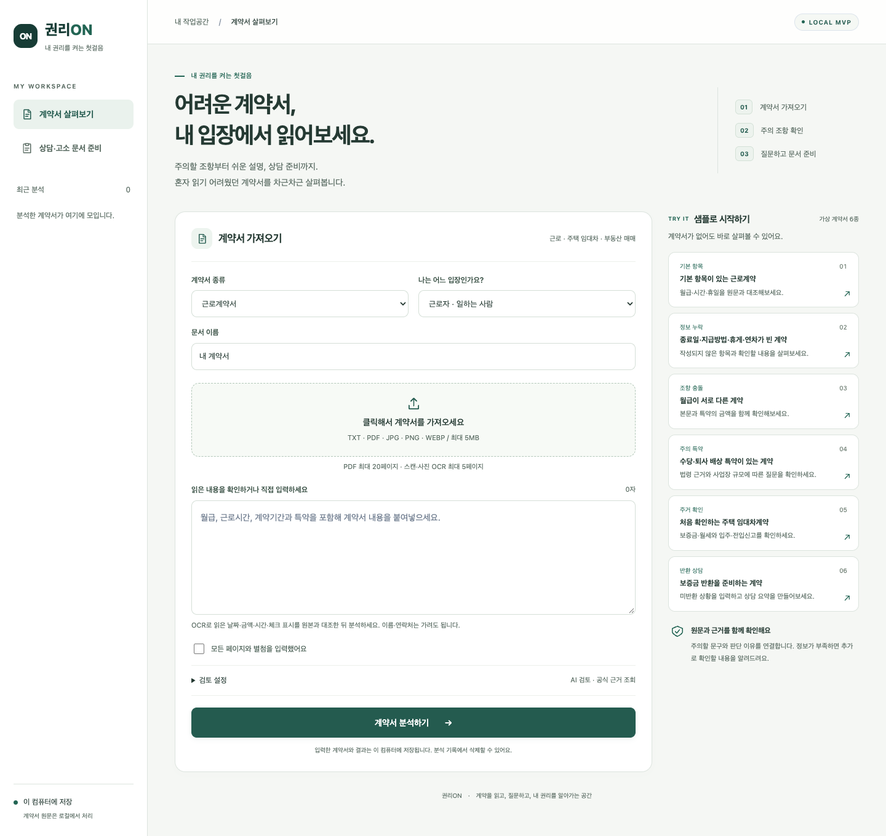
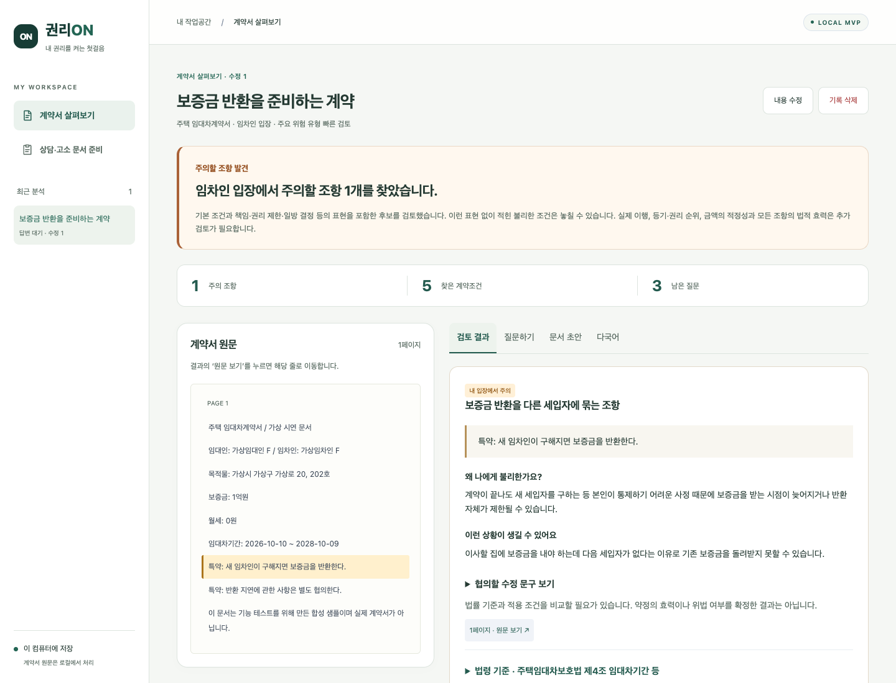
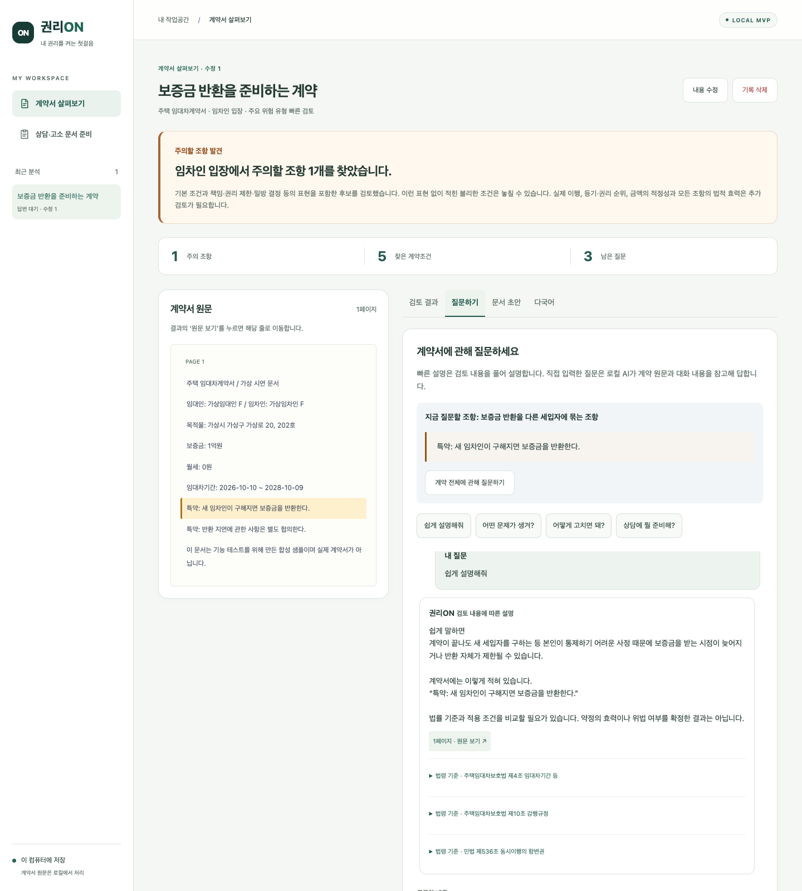
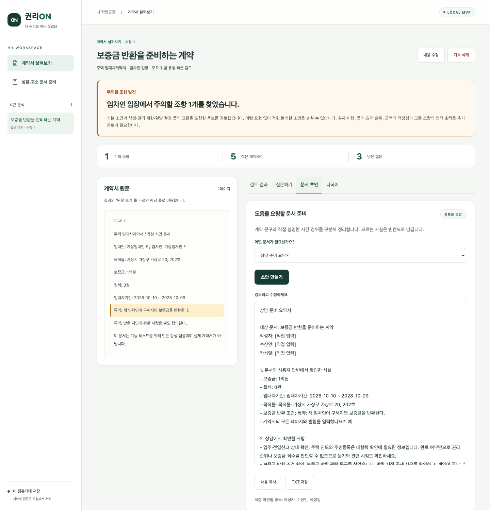
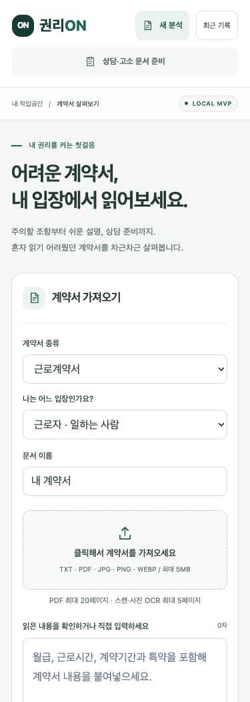
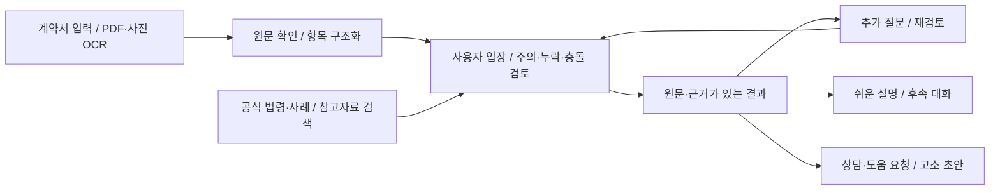

<div align="center">

# 권리ON · GwolliON LegalAI

**어려운 계약서, 내 입장에서 읽어보세요.**

계약서의 주의 조항을 원문·근거와 함께 확인하고,<br>
쉬운 설명과 후속 질문을 거쳐 상담 문서 초안까지 준비하는 로컬 법률 AI MVP입니다.

`Python` · `FastAPI` · `SQLite` · `Ollama / Qwen` · `Tesseract OCR`

[화면 미리보기](#mvp-화면) · [빠른 시작](#빠른-시작) · [구현 현황](#지금까지-구현한-내용) · [검증](#검증) · [상세 문서](docs/mvp-details.md)

</div>

## MVP 화면

실행 중인 앱에서 합성 샘플로 캡처한 화면입니다. 결과·대화·초안 예시는 **빠른 검토 + 저장된 법령 + 조항별 빠른 설명**을 사용했습니다. 실제 로컬 AI 검토와 자유 질문은 Ollama를 별도로 준비하면 사용할 수 있습니다.

### 1. 계약서 가져오기

계약 종류와 본인의 입장을 선택하고 TXT·PDF·사진을 가져오거나 내용을 직접 입력합니다. 오른쪽의 가상 계약서 6종으로 바로 시작할 수 있습니다.



### 2. 원문과 함께 보는 검토 결과

주의 조항, 불리한 이유, 상황 예시와 수정 제안을 확인합니다. **원문 보기**를 누르면 해당 문구로 이동하고, 근거 자료와 추가 질문도 펼쳐볼 수 있습니다.



<details>
<summary><strong>질문하기 · 문서 초안 · 모바일 화면 펼쳐보기</strong></summary>

### 3. 조항에 관해 질문하기

쉬운 설명·상황 예시·수정 문구를 빠르게 확인합니다. 직접 입력하는 자유 질문은 로컬 AI가 계약서와 이전 대화를 참고해 답합니다.



### 4. 상담에 필요한 문서 준비

상담 요청문·도움 요청문·고소장 초안·상담 요약서·사실확인 요청문을 작성하고 수정·복사·TXT 저장합니다. 계약서 없이 사건 경위만으로 문서를 준비하는 화면도 있습니다.



### 5. 모바일

작은 화면에서는 입력과 결과를 세로로 배치하고 최근 기록을 접어 확인합니다.



</details>

## 지금까지 구현한 내용

| 영역 | 현재 구현 |
| --- | --- |
| 문서 읽기 | TXT·PDF 직접 추출, 사진·스캔·혼합 PDF의 페이지별 한국어 OCR, 읽은 텍스트 수정 |
| 계약조건 구조화 | 기간·임금·시간·휴일·보증금 등의 후보와 원문 근거 보존, 누락·충돌 확인, JSON 다운로드 |
| 사용자 입장 검토 | 근로자/사업주, 임차인/임대인, 매수인/매도인 구분. 빠른 규칙 검토와 로컬 AI 의미 검토 |
| 결과와 추가 질문 | 주의 조항 / 추가 확인 필요 / 검토 범위에서 이상 없음, 답변에 따른 재검토와 revision 관리 |
| 근거 검색 | 저장된 공식 법령, 사건 날짜 기준 공식 법령·판례·법령해석·행정심판례 조회, 출처·인용 대조 |
| 후속 대화 | 조항별 빠른 설명·예시·수정 제안, 실제 Ollama 자유 질문, revision별 대화 보관 |
| 문서 초안 | 상담·도움 요청문, 고소장 초안, 상담 요약서, 사실확인 요청문. 입력한 사실과 미확인 항목 구분 |
| 다국어 안내 | 중국어 간체·스페인어 안내 템플릿, 원문·금액·출처 유지 |
| 로컬 작업공간 | SQLite 분석 기록·대화 저장과 삭제, 반응형 화면, 키보드 탭 이동, 샘플 TXT/PDF 6종 |
| 데이터 준비 | 38개 ZIP·182,424개 JSON의 CRC 점검 및 검색 색인 구축. 런타임은 Training만 검색하며 Validation과 동일 원문인 자료 제외 |

저장소에는 **공식 법령 6종·2,098개 조문 색인**과 합성 샘플을 포함했습니다. 대용량 데이터·계획서 원본, 약 2.9GB의 로컬 참고자료 색인, 개인 분석 기록과 API 설정은 포함하지 않습니다. 데이터 구축·AI 검증의 상세 기록과 한계는 [구현 및 검증 상세](docs/mvp-details.md)에 정리했습니다.

## 빠른 시작

Python 3.10 이상이 필요합니다. 기본 샘플과 빠른 검토는 API 키·로컬 모델 없이 실행할 수 있습니다.

```bash
git clone https://github.com/mjeon01/GwolliON-LegalAI.git
cd GwolliON-LegalAI
python3 -m venv .venv
.venv/bin/python -m pip install -r requirements.txt
./run_app.sh
```

브라우저에서 **http://127.0.0.1:8020** 을 엽니다.

1. 샘플 계약서를 선택합니다.
2. **검토 설정**을 펼쳐 **빠른 검토**를 선택하고, **공식 법령과 관련 사례도 조회**를 해제합니다.
3. **계약서 분석하기**를 누릅니다.
4. 결과에서 원문·주의 조항을 확인하고 **질문하기 → 문서 초안**으로 이어갑니다.

다른 포트는 `GWOLLION_PORT=8021 ./run_app.sh`로 실행합니다. 서버는 `127.0.0.1`에서만 접속받습니다.

### 선택 기능 설정

```bash
cp .env.example .env
```

| 기능 | 준비 방법 |
| --- | --- |
| AI 검토·자유 질문 | Ollama 설치 후 `ollama pull qwen2.5:7b`, `ollama serve`. `.env`의 `OLLAMA_URL`, `OLLAMA_MODEL`로 변경 가능 |
| 공식 근거 조회 | 국가법령정보 공동활용에서 발급받은 OC를 `.env`의 `legal_api_key`에 입력 |
| 사진·스캔 OCR | macOS: `brew install tesseract` 후 `.venv/bin/python scripts/setup_ocr.py` |
| 전체 참고자료 검색 | 별도로 확보한 데이터 ZIP을 `data/`에 배치한 뒤 `.venv/bin/python scripts/build_reference_index.py` |

설정을 준비하지 않은 기능은 선택을 해제하고 시작하세요. 상태는 [`/api/health`](http://127.0.0.1:8020/api/health), 참고자료 색인은 [`/api/evidence/status`](http://127.0.0.1:8020/api/evidence/status)에서 확인합니다. OCR·공식 API·AI 검토의 상세 동작은 [상세 문서](docs/mvp-details.md)를 참고하세요.

## 처리 흐름과 코드 구조



```text
mvp/                 FastAPI, 읽기·추출·검토·검색·대화·초안·저장 모듈
  static/            HTML · CSS · JavaScript 화면
resources/           공개 법령 조문 색인
samples/             합성 계약서 TXT 6종과 시나리오 명세
output/pdf/          샘플 PDF 6종
scripts/             데이터·법령 점검, 색인 생성, 평가, 화면 캡처
tests/               단위·API 테스트와 브라우저 회귀 시나리오
docs/                MVP 상세 설명과 실제 화면 이미지
obsidian/            설계·데이터·API·평가·구현 기록
```

분석 생성은 `POST /api/analyses` → `202` 작업 ID → `GET /api/analyses/{id}` 순서입니다. 답변·대화·초안은 최신 `analysis_revision`을 사용하고, 오래된 결과에 대한 요청은 `409`로 거절합니다. API 명세는 [`/openapi.json`](http://127.0.0.1:8020/openapi.json)에서 확인합니다.

## 검증

**2026-10-19:** 단위·API 테스트 **73개 통과**. 화면 정리 후 브라우저 회귀와 375·768·1024·1440px 배치, 키보드 탭 이동, 메뉴 선택 상태와 실제 샘플 캡처를 확인했습니다.

```bash
.venv/bin/python -m unittest discover -s tests -v

# 실행 중인 로컬 서버 + Playwright / Chromium 필요
node tests/e2e.mjs
node tests/e2e-review.mjs
```

브라우저 도구는 `npm install --no-save --package-lock=false playwright`와 `npx playwright install chromium`으로 준비할 수 있습니다. 기존 설치는 `PLAYWRIGHT_MODULE`, Chrome 실행파일은 `CHROME_PATH`, 다른 서버는 `GWOLLION_URL`로 지정합니다.

실제 로컬 AI는 `node tests/e2e-review.mjs --ai`, 공식 API는 `node tests/e2e-evidence.mjs`로 따로 검증합니다. **2026-10-11**에 실제 Qwen 검토·대화와 공식 근거·과거 날짜 재조회까지 확인한 기록이 있습니다. 이번 화면 정리에서는 외부 API·AI 검증을 다시 실행하지 않았습니다. 테스트 통과율은 실제 계약에 대한 법률 판단 정확도를 의미하지 않습니다.

<details>
<summary>README 화면 다시 캡처하기</summary>

개인 기록이 섞이지 않도록 전용 빈 DB를 사용하는 서버를 실행하고, 다른 터미널에서 캡처합니다.

```bash
GWOLLION_DB=var/readme-preview/analyses.sqlite3 GWOLLION_PORT=8021 ./run_app.sh
node scripts/capture_mvp.mjs
```

캡처 스크립트는 합성 샘플만 사용하고 생성한 분석을 끝나면 삭제합니다. 기존 기록이 있으면 실행을 중단합니다. 이미지는 `docs/images/`에 저장됩니다.

</details>

## 현재 범위와 다음 작업

문서 업로드는 **5MB·20페이지·50,000자**, OCR은 최대 **5페이지**, AI 검토와 자유 질문은 문서 **6,000자** 범위입니다. 계약서 원문·분석 결과·대화는 로컬 SQLite에 저장되며 화면에서 삭제할 수 있습니다. 공식 API에는 법령명과 일반 쟁점만 보내고 계약서 원문·사건 경위는 보내지 않습니다.

현재는 법률·번역 전문가 검수 전의 MVP입니다. 일부만 입력했거나 OCR·공식 조회에 확인할 문제가 있으면 결과에서 이를 알립니다. 고소장 등은 사용자가 입력한 사실을 정리하는 검토용 초안이며, 범죄 성립이나 법적 효력을 확정하지 않습니다.

- [ ] 단시간·기간제·외국인근로자 전용 서식과 검증 항목 확장
- [ ] 전문가 정답을 확보한 오경고·누락 평가 및 법률·번역 검수
- [ ] LoRA 학습 전후를 동일 평가셋에서 비교
- [ ] 최저임금·손해액 계산, 등기·증빙 교차 확인
- [ ] 인증·다중 사용자·운영 배포

설계와 결정 기록은 [Obsidian 구현 가이드](obsidian/00%20권리ON%20전문기%20구현%20가이드.md), 상세 기능·재현 명령은 [MVP 구현 및 검증 상세](docs/mvp-details.md)에 있습니다.
