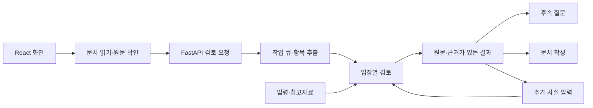

# 백엔드와 데이터 관리

현재 실행 방법과 화면 기능은 [프로젝트 README](../README.md), 화면 구현은 [프런트엔드 안내](../frontend/README.md)를 기준으로 합니다. 모든 명령은 프로젝트 루트에서 실행합니다.

## 코드 구조

| 파일 | 역할 |
| --- | --- |
| `backend/app.py` | API, 로컬 요청 검증, 백그라운드 작업, React 빌드 제공 |
| `backend/schemas.py` | 입력·답변·대화·문서 요청 스키마 |
| `backend/reading.py` | TXT·PDF 추출과 Tesseract OCR |
| `backend/extraction.py`, `structure.py` | 계약조건 후보 추출, 원문 대조, 누락·충돌 확인 |
| `backend/analysis.py`, `review.py` | 사용자 입장별 규칙 검토와 Ollama 의미 검토 |
| `backend/knowledge.py`, `retrieval.py` | 저장 법령과 쟁점별 근거 검색, 인용 검증 |
| `backend/legal_api.py`, `corpus.py` | 공식 근거 조회와 로컬 참고자료 검색 |
| `backend/chat.py`, `documents.py` | 후속 대화, 문서·안내 템플릿 |
| `backend/store.py` | SQLite 기록·revision·대화 저장 |



`frontend/dist/`가 없으면 웹 페이지는 실행 방법을 안내하는 503 응답을 보냅니다. `./run_app.sh`가 빌드를 먼저 생성합니다. API는 화면 빌드 없이도 테스트할 수 있습니다.

## API 계약

`/openapi.json`에 전체 요청 스키마가 있습니다.

| 요청 | 동작 |
| --- | --- |
| `POST /api/uploads` | 파일에서 텍스트 읽기 |
| `POST /api/analyses` | 202와 작업 ID 반환 |
| `GET /api/analyses/{id}` | 진행 상태 또는 검토 결과 |
| `POST /api/analyses/{id}/answers` | 추가 사실로 재검토, revision 증가 |
| `GET/POST /api/analyses/{id}/chat` | 해당 revision의 대화 조회·추가 |
| `POST /api/analyses/{id}/drafts` | 계약서 기반 초안 |
| `GET/DELETE /api/analyses/{id}` | 결과 조회·삭제 |
| `GET /api/samples/{id}/pdf` | `samples/pdf/`의 가상 계약서 다운로드 |

답변·대화·초안 요청에는 최신 `analysis_revision`이 필요합니다. 오래된 revision은 409로 거절합니다. 삭제되거나 갱신된 결과를 늦게 도착한 작업이 되살리지 않도록 저장 단계에서도 확인합니다.

백엔드에는 독립 사건 문서, 추가 문서 종류, 번역 템플릿, 공식 근거 조회 API도 남아 있습니다. 현재 메뉴에는 검토·질문·상담 문서·기록만 노출합니다.

## 로컬 데이터

| 경로 | 내용 |
| --- | --- |
| `samples/*.txt`, `samples/pdf/`, `samples/manifest.json` | 공개 가능한 합성 계약서 6종과 테스트 기대값 |
| `resources/law-index.json` | 저장된 공식 법령 조문 색인 |
| `data/` | 확보한 원본 ZIP·서식. Git 제외 |
| `var/mvp/analyses.sqlite3` | 기존 사용자 원문·검토·대화. `GWOLLION_DB`로 변경 가능 |
| `var/corpus/reference.sqlite3` | 참고자료 검색 색인 |
| `var/ocr/tessdata/` | 한국어·영어 OCR 모델. `GWOLLION_TESSDATA`로 변경 가능 |
| `var/evidence-cache/` | 공식 근거 응답 캐시 |
| `var/law-api/`, `var/data-inspection/`, `var/evaluation/` | 색인 원본과 데이터·평가 보고서 |

참고자료 검색은 Training 자료를 사용하며 Validation과 동일 원문 해시인 자료를 제외합니다. 계약 항목 라벨을 위법 여부의 정답으로 사용하지 않습니다. 저장된 법령과 참고자료의 시점은 실제 조회·수집 시점을 기준으로 확인해야 합니다.

## 유지보수 명령

```bash
# 원본 ZIP 목록과 스키마 점검
.venv/bin/python scripts/inspect_downloaded_data.py

# 로컬 참고자료 색인 생성
.venv/bin/python scripts/build_reference_index.py

# 공식 법령 조회 결과 확인 후 공개 조문 색인 갱신
.venv/bin/python scripts/check_law_api.py
.venv/bin/python scripts/build_law_index.py

# 합성 샘플 TXT/PDF 재생성
.venv/bin/python scripts/create_samples.py

# 계약 항목·조항 회귀 평가
.venv/bin/python scripts/evaluate_contracts.py
```

샘플 PDF 재생성에는 한국어 TTF 글꼴이 필요하며 `GWOLLION_PDF_FONT`로 지정할 수 있습니다. 기존 샘플을 사용하거나 테스트할 때는 재생성할 필요가 없습니다.

공식 API는 `.env`의 `legal_api_key`를 OC 값으로 사용합니다. 기본 주소는 `https://www.law.go.kr/DRF/lawSearch.do`와 `https://www.law.go.kr/DRF/lawService.do`입니다. 각각 `legal_api_search_url`, `legal_api_service_url`로 설정합니다. 조회 응답의 법령명·ID·시행일과 본문을 대조하고, 인증값을 제거한 응답을 캐시합니다. 공식 API에는 미리 정의한 일반 법률 쟁점만 전달합니다.

## 검증 범위

`tests/`는 추출·누락·충돌, 당사자 의무와 인용 검증, 저장·삭제·revision, 문서 템플릿, OCR 오류 처리, 공식 API 검증, 웹 경로·정적 자산·샘플 PDF 연결을 검사합니다. 테스트는 임시 분석 DB를 사용합니다. 실제 모델과 외부 API 호출은 모의 응답으로 대체하므로 자동 검사 통과만으로 실제 답변의 정확도를 보장하지 않습니다.
