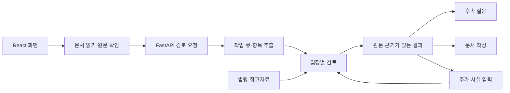

# 백엔드와 데이터 관리

현재 실행 방법과 화면 기능은 [프로젝트 README](../README.md), 화면 구현은 [프런트엔드 안내](../frontend/README.md)를 기준으로 합니다. 모든 명령은 프로젝트 루트에서 실행합니다.

## 코드 구조

| 파일 | 역할 |
| --- | --- |
| `backend/app.py` | API, 로컬 요청 검증, 백그라운드 작업, React 빌드 제공 |
| `backend/config.py` | 서버 전용 `.env` 읽기. 명령행 스크립트도 같은 함수를 사용 |
| `backend/law_client.py` | 공식 법령 HTTP 요청·주소 검증·비밀값 제거·구조화된 조문 텍스트 추출 |
| `backend/schemas.py` | 입력·답변·대화·문서 요청 스키마 |
| `backend/reading.py` | TXT·PDF 직접 추출, 메타데이터 제거, 페이지별 OpenAI 판독·Tesseract OCR |
| `backend/pages.py` | 문서 표시용 페이지 이미지·단어 좌표 생성, 검토 근거의 문서 내 위치 계산 |
| `backend/pdf_export.py` | 편집한 문서의 PDF 생성 (`resources/fonts/`의 Pretendard, OFL) |
| `backend/auto_translation.py` | Ollama 참고 번역, 값 고정과 숫자·당사자 역할 검사 |
| `backend/extraction.py`, `structure.py` | 계약조건 후보 추출, 원문 대조, 누락·충돌 확인 |
| `backend/analysis.py`, `review.py` | 사용자 입장별 규칙 검토와 OpenAI·Ollama 의미 검토 |
| `backend/knowledge.py`, `retrieval.py` | 저장 법령과 쟁점별 근거 검색, 인용 검증 |
| `backend/legal_api.py`, `corpus.py` | 공식 근거 조회와 로컬 참고자료 검색 |
| `backend/chat.py`, `documents.py` | 후속 대화, 문서·안내 템플릿 |
| `backend/chat_translation.py`, `streaming.py` | 로컬 대화 번역·의미 검사, 검증된 답변의 SSE 전달 |
| `backend/openai_client.py` | `store:false` Responses API, 엄격한 JSON 검증, 안전한 오류·사용량 로그 |
| `backend/translation.py` | 원문 값 고정, 역할·의미 검사, 검토·문서·사건 경위 번역 |
| `backend/store.py` | SQLite 기록·revision·대화·내용별 번역 캐시 저장 |

서버는 `scripts/`를 가져오지 않습니다. `scripts/check_law_api.py`와 `scripts/build_law_index.py` 등 명령행 도구가 `backend/`의 공용 함수를 사용합니다.



`frontend/dist/`가 없으면 웹 페이지는 실행 방법을 안내하는 503 응답을 보냅니다. `./run_app.sh`가 빌드를 먼저 생성합니다. API는 화면 빌드 없이도 테스트할 수 있습니다.

## API 계약

`/openapi.json`에 전체 요청 스키마가 있습니다.

| 요청 | 동작 |
| --- | --- |
| `POST /api/uploads` | 기존 `file` 또는 `files` 배열, `reading_mode=local/openai`, `rotations=[0,90,…]` |
| `POST /api/analyses` | 202와 작업 ID 반환. 업로드 응답의 `document_id`를 넘기면 문서 표시용 페이지를 연결 |
| `POST /api/samples/{id}/document` | 샘플 PDF의 문서 표시용 페이지를 만들고 `document_id` 반환 |
| `GET /api/analyses/{id}/document` | 페이지 크기와 근거별 표시 위치(`highlights`, 페이지 대비 0~1 좌표, `exact`/`approximate`) |
| `GET /api/analyses/{id}/pages/{page}` | 문서 표시용 페이지 JPEG |
| `GET /api/analyses/{id}` | 진행 상태 또는 검토 결과 |
| `POST /api/analyses/{id}/auto-translation` | `language=zh/es`. 로컬 번역을 시작하거나 진행 상태 조회, 완료 시 revision별 캐시 |
| `POST /api/documents/pdf` | `title`, `text`로 PDF 생성 |
| `POST /api/analyses/{id}/answers` | 추가 사실로 재검토, revision 증가 |
| `GET/POST /api/analyses/{id}/chat` | 해당 revision의 대화 조회·추가 |
| `POST /api/analyses/{id}/drafts` | 계약서 기반 초안 |
| `GET/DELETE /api/analyses/{id}` | 결과 조회·삭제 |
| `POST /api/analyses/{id}/translations` | `language=zh/es`, 새 UI는 `engine=openai`로 실제 조항 설명 번역 (기본 template 유지) |
| `POST /api/analyses/{id}/document-translations` | 편집한 `text`와 선택 언어의 번역, 내용 해시 포함 |
| `POST /api/analyses/{id}/incident-translations` | 사건 경위를 한국어로 해석, 확인 후 초안 요청에 반영 |
| `GET /api/samples/{id}/txt` | 합성 계약서 TXT 다운로드 |
| `GET /api/samples/{id}/pdf`, `/png` | `samples/pdf/`, `samples/images/`의 계약서 다운로드 |

답변·대화·초안 요청에는 최신 `analysis_revision`이 필요합니다. 오래된 revision은 409로 거절합니다. 삭제되거나 갱신된 결과를 늦게 도착한 작업이 되살리지 않도록 저장 단계에서도 확인합니다.

`AnalyzeRequest.engine`은 `rules`(기본), `ollama`, `openai`입니다. 현재 UI는 클라우드 기능을 숨기고 `engine=rules`, 자유 질문 `engine=ollama`, 요청 언어는 화면의 `ko/zh/es`를 명시합니다. `ChatRequest`는 `engine=ollama/openai`와 `language=ko/zh/es`를 받으며, 기존 기본값은 유지합니다. 외국어 질문은 한국어 해석과 기존 검증을 거친 답변을 번역하고 질문 원문·한국어 해석을 함께 보관합니다.

새 업로드 결과의 `reading.pages`에는 `page`, `text`, `method`, `status`, `warnings`, `confirmed`, `error_code`가 있습니다. `page_previews`는 메타데이터가 없는 비교용 이미지이며 DB에 저장하지 않습니다. 검토 화면에 표시할 페이지는 `document_pages` 테이블에 별도로 저장합니다(TXT는 없음). PDF 텍스트 페이지는 단어 좌표를 바로 쓰고, 사진·스캔은 검토 시작 시 Tesseract로 좌표를 구합니다. 좌표를 못 찾으면 읽은 텍스트 위에 표시합니다. 한 페이지 실패도 배열에서 제거하지 않습니다. 분석 요청의 페이지 순서·확인 표시·텍스트 연결을 검증합니다. 기존 단일 `file` + 로컬 요청의 응답·오류 동작은 호환됩니다.

외국어 사건 경위를 쓰는 초안은 `incident_original`, 확인·수정한 `incident`, `incident_confirmed=true`가 필요합니다. 한국어 문서 생성은 기존 사실 기반 템플릿을 유지합니다. 번역은 별도 요청이므로 실패해도 편집한 한국어 문서를 잃지 않습니다. 캐시 저장은 삭제·revision 경쟁 상태도 검사합니다.

## 로컬 데이터

| 경로 | 내용 |
| --- | --- |
| `samples/` | 화면에 보이는 계약서 5종(TXT·PDF·PNG)과 기대값. `scripts/create_samples.py`로 생성 |
| `tests/fixtures/samples/` | 테스트 전용 합성 계약서 10종. `scripts/create_test_fixtures.py`로 생성 |
| `resources/law-index.json` | 저장된 공식 법령 조문 색인 |
| `data/` | 확보한 원본 ZIP·서식. Git 제외 |
| `var/mvp/analyses.sqlite3` | 기존 사용자 원문·검토·대화. `GWOLLION_DB`로 변경 가능 |
| `var/corpus/reference.sqlite3` | 참고자료 검색 색인 |
| `var/ocr/tessdata/` | 한국어·영어 OCR 모델. `GWOLLION_TESSDATA`로 변경 가능 |
| `var/evidence-cache/` | 공식 근거 응답 캐시 |
| `var/law-api/`, `var/data-inspection/`, `var/evaluation/` | 색인 원본과 데이터·평가 보고서 |

참고자료 검색은 Training 자료를 사용하며 Validation과 동일 원문 해시인 자료를 제외합니다. 계약 항목 라벨을 위법 여부의 정답으로 사용하지 않습니다. 저장된 법령과 참고자료의 시점은 실제 조회·수집 시점을 기준으로 확인해야 합니다.

## 유지보수 명령

```bash
# 원본 ZIP 목록과 스키마 점검
.venv/bin/python scripts/inspect_downloaded_data.py

# 로컬 참고자료 색인 생성
.venv/bin/python scripts/build_reference_index.py

# 공식 법령 조회 결과 확인 후 공개 조문 색인 갱신
.venv/bin/python scripts/check_law_api.py
.venv/bin/python scripts/build_law_index.py

# 합성 샘플 TXT/PDF 재생성
.venv/bin/python scripts/create_samples.py

# 계약 항목·조항 회귀 평가
.venv/bin/python scripts/evaluate_contracts.py
```

샘플 PDF 재생성에는 한국어 TTF 글꼴이 필요하며 `GWOLLION_PDF_FONT`로 지정할 수 있습니다. 기존 샘플을 사용하거나 테스트할 때는 재생성할 필요가 없습니다.

공식 API는 `.env`의 `legal_api_key`를 OC 값으로 사용합니다. 기본 주소는 `https://www.law.go.kr/DRF/lawSearch.do`와 `https://www.law.go.kr/DRF/lawService.do`입니다. 각각 `legal_api_search_url`, `legal_api_service_url`로 설정합니다. 조회 응답의 법령명·ID·시행일과 본문을 대조하고, 인증값을 제거한 응답을 캐시합니다. 공식 API에는 미리 정의한 일반 법률 쟁점만 전달합니다.

## 검증 범위

`tests/`는 추출·누락·충돌, 당사자 의무와 인용 검증, 저장·삭제·revision, 문서 템플릿, OCR 오류 처리, 공식 API 검증, 웹 경로·정적 자산·샘플 PDF 연결을 검사합니다. 테스트는 임시 분석 DB를 사용합니다. 실제 모델과 외부 API 호출은 모의 응답으로 대체하므로 자동 검사 통과만으로 실제 답변의 정확도를 보장하지 않습니다.


## OpenAI와 보관 범위

`.env` 또는 서버 환경의 `OPENAI_API_KEY`, `OPENAI_MODEL`(기본 `gpt-5.4-mini`)을 사용합니다. 키를 API 응답에 포함하지 않습니다. 요청은 공개 이미지 주소 없이 base64 이미지와 `store:false`를 사용합니다. 인증·한도·시간 초과·거절·미완료·잘못된 JSON은 별도 오류 코드로 표시하며 자동 로컬 전환은 없습니다.

조항은 7,000자·35블록 이하 묶음으로 검토합니다. 모든 블록 ID가 완료·부분 완료·실패 범위에 포함됩니다. 잘못된 인용·법령 ID·당사자 의무가 있는 후보는 제외하며, 일부 실패 결과를 전체 검토 완료로 표시하지 않습니다. 과도한 단일 조항과 전 범위 실패는 재시도를 안내합니다.

`translations` 테이블은 `(analysis_id, revision, language, purpose, source_hash)`로 캐시를 구분합니다. 기존 분석·대화 테이블과 DB 경로를 유지합니다. 분석 삭제 시 번역도 삭제합니다. 이미지 원본은 요청 종료 시 제거하고 원문·검토·대화·번역은 로컬 DB에 남습니다. 브라우저 초안 임시 저장과 별개입니다.

`store:false`는 완전한 무보관 보장이 아닙니다. [OpenAI 데이터 보관 정책](https://developers.openai.com/api/docs/guides/your-data)을 클라우드 기능이 활성화된 UI에서 연결합니다. 모델 호출 로그에는 모델·사용 토큰·경과 시간·오류 코드만 남습니다.

### 질문 스트리밍

`POST /api/analyses/{id}/chat/stream`은 기존 `ChatRequest`와 동일한 본문을 받고 `text/event-stream`으로 응답합니다. `status`(preparing/generating/verifying/retrying/translating), 검증·DB 저장 후 `delta`(text), 최종 `done`(기존 응답 구조) 순서입니다. 요청 시작 전에 확인된 revision 오류는 HTTP 오류이고, 생성 중 오류는 `error` 이벤트(detail/status)입니다. 기존 JSON `/chat`은 유지합니다. Ollama는 `stream:true` NDJSON을 사용하며 완료 신호 없는 연결 종료나 토큰 한도는 실패로 처리합니다. 원시 JSON·미검증 답변·수정 전 답변을 브라우저에 내보내지 않습니다. 클라이언트 연결 종료 시 생성 취소 표시를 전달하며 취소된 작업은 대화를 저장하지 않습니다.

`POST /api/analyses/{id}/chat/{turn}/translation`은 기존 답변을 선택 언어로 번역하며, 분석 ID·revision·대화 순서·언어·한국어 원문 해시로 캐시합니다. 대화 자체를 덮어쓰지 않습니다. 로컬 다국어 질문은 `backend/chat_translation.py`를 사용해 OpenAI 없이 질문 해석 → 원문·근거 검증 → 선택 언어 번역을 수행합니다. 금액·날짜·인용·명시된 당사자는 토큰으로 고정하고, 번역 언어와 모델의 의미 대조를 확인합니다. 원문을 그대로 반환한 응답은 번역 성공으로 처리하지 않습니다.
