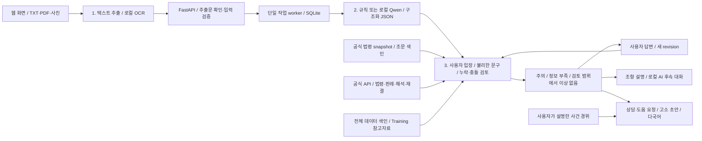

# 권리ON — MVP 구현 및 검증 상세

> 2026-10-11까지의 구현 기록입니다. 현재 실행 방법·화면·진행 현황은 [README](../README.md)를 먼저 확인하세요. 아래 실행 명령은 저장소 루트 기준입니다.

로컬 웹 화면에서 **내게 불리한 조항 찾기 → 쉬운 설명과 후속 대화 → 수정 협의·상담·고소 준비 문서 작성**으로 이어지는 MVP다. 근로계약서, 주택 임대차계약서와 부동산 매매계약서를 본인의 입장에서 검토한다. 문서 읽기·항목 구조화·누락 확인은 이 검토를 뒷받침한다.

## MVP 실행

현재 환경에는 `.venv`와 필요한 패키지가 준비되어 있다.

```bash
./run_app.sh
```

브라우저에서 **http://127.0.0.1:8020** 을 연다. 다른 포트를 쓰려면 `GWOLLION_PORT=8021 ./run_app.sh`로 실행한다. 서버는 이 컴퓨터의 루프백 주소에서만 접속받는다.

새 환경에서는 Python 3.10 이상으로 준비한다.

```bash
python3 -m venv .venv
.venv/bin/python -m pip install -r requirements.txt
./run_app.sh
```

1. 첫 화면에서 샘플 하나를 선택하거나 계약서 내용을 입력한다.
2. 읽은 텍스트를 원본과 대조하고, 계약 종류·본인의 입장·검토 방식을 선택해 **계약서 분석하기**를 누른다.
3. 결과 상단에서 **주의 조항 발견 / 추가 확인 필요 / 이번 검토 범위에서 이상 없음**을 확인한다. 주의 조항은 원문, 불리한 이유, 조건부 상황 예시, 협의용 수정 문구와 근거를 제공한다.
4. 상황 질문에 답해 분석을 갱신한다.
5. **질문하기**에서 쉬운 설명·상황 예시·수정 문구를 확인하거나 자유 질문을 보낸다. 자유 질문은 실제 로컬 AI를 호출하며 이전 대화를 참고한다.
6. **문서 초안**에서 변호사 상담 요청문, 도움 요청문, 고소장 초안 등을 만들고 수정·복사·TXT 저장한다. 고소 초안에는 사건 경위를 직접 입력해야 한다.
7. **다국어**에서 중국어 간체·스페인어 안내를 확인한다. 신규 조항의 안내 템플릿이 없는 경우 한국어 설명으로 표시한다.

계약서가 없어도 메뉴의 **상담·고소 문서 준비**에서 사건 경위를 입력해 초안을 만들 수 있다. 이 별도 화면의 사건 경위와 초안은 서버 기록으로 저장하지 않는다.

샘플 6종은 `samples/*.txt`, `output/pdf/*.pdf`에 있다. 첫 화면에서 해당 샘플 PDF를 내려받을 수 있다. 모든 샘플은 직접 만든 **합성 문서**이며 실제 계약서나 AI Hub 평가 정답이 아니다.

근로 샘플 4종은 제공받은 `data/표준근로계약서(서식).hwp`의 일반형을 참고해 A4 한 장에 번호별 조항, 지급 선택란, 보험 체크란, 서명란을 배치했다. [고용노동부 근로계약서 안내](https://www.moel.go.kr/mainpop2.do)를 함께 참고했다. 실제 서식을 수정한 원본이나 완성된 법률 문서가 아닌 테스트용 가상 계약이다. `scripts/create_samples.py`로 TXT/PDF를 함께 재생성한다.

| 샘플 | 확인할 흐름 |
| --- | --- |
| `employment-basic` | 기본 항목 추출·원문 대조 |
| `employment-missing` | 종료일·지급일·지급방법·휴게·연차의 빈칸과 추가 질문 |
| `employment-conflict` | 본문·특약의 서로 다른 월급 후보 보존 |
| `employment-attention` | 배상·수당·주당 시간, 사업장 규모·날짜 질문 |
| `lease-basic` | 보증금·월세, 입주·전입신고 확인 |
| `lease-return` | 보증금 반환 특약, 미반환 답변과 상담 준비 |

## 구현 범위

- **1단계 문서 읽기 (`mvp/reading.py`):** 텍스트 PDF는 직접 추출하고 사진·스캔 페이지는 로컬 Tesseract 한국어 OCR로 읽는다. 혼합 PDF도 페이지별로 읽으며 페이지 번호를 보존한다. VLM은 아직 연결하지 않았다.
- **2단계 항목 구조화 (`mvp/extraction.py`, `mvp/structure.py`):** 규칙 또는 실제 로컬 Ollama 추출 후보를 원문과 대조하고 `structured_contract` JSON으로 정리한다. 계약기간, 장소, 업무, 근무·휴게시간, 임금·지급일·지급방법, 휴일·연차를 포함한다. 원문에 없거나 충돌하는 값은 `null`로 남기고 `terms`에 후보·원문 근거를 보존한다.
- **사용자 입장 검토 (`mvp/review.py`):** 근로자·사업주, 임차인·임대인, 매수인·매도인을 구분한다. 퇴사 배상, 수당 포함, 임금 공제, 연차 포기, 이직 제한, 조건부 보증금 반환, 과도한 수선 부담, 전입신고 제한, 일방 해지, 매매 선이행·해제 조건 등 명시된 유형을 규칙으로 확인한다. AI 방식은 추가로 전체 입력 문구의 부담을 의미 단위로 검토한다. 정상적인 종료 시 보증금 반환은 그 자체로 경고하지 않는다.
- **결과 (`review`):** `warning`은 구체적 주의 조항, `needs_information`은 누락·충돌·OCR·미완료 검토 등 확인할 정보, `clear`는 이번 검토 범위에서 불리한 문구를 찾지 못한 결과다. OCR 문서나 일부만 입력한 문서에는 이상 없음 결과를 주지 않는다. 어떤 결과도 모든 법적 효력·실제 이행·권리 순위를 보장하지 않는다.
- **항목 검증 (`mvp/structure.py`, `mvp/analysis.py`):** `validation_checks`에 항목별 확인·누락 가능성·충돌을 기록한다. 무기계약의 종료일은 누락으로 표시하지 않는다. `terms`의 후보·원문과 구조화 JSON은 접힌 상세 영역에서 확인한다.
- **근거 (`mvp/legal_api.py`, `mvp/retrieval.py`):** 공식 API에서 사건 날짜까지 시행된 법령 버전과 관련 판례·법령해석을 조회한다. 행정처분 쟁점에는 행정심판례도 조회한다. 목록·본문의 이름·ID·시행일 또는 사건번호·판단일을 대조한다. 기본 법령 외에도 단시간·기간제, 퇴직급여, 최저임금, 상가임대차 근거를 쟁점에 따라 가져온다. 저장된 공식 법령 6종·2,098개 조문은 로컬 모드 및 조회 실패 시 참고 자료로 유지한다. 공식 조회 실패를 숨기지 않으며 법령 조회 실패 시 `clear`를 주지 않는다.
- **전체 데이터 (`mvp/corpus.py`):** 38개 ZIP의 182,424개 JSON을 CRC 검사를 거쳐 SQLite 검색 색인에 저장했다. 원문·계약 항목 라벨·질의응답·요약을 자료 유형별로 보관한다. 검색은 Training만 사용하고 Validation 및 검증 자료와 동일 원문 해시인 Training 자료를 제외한다. 데이터의 법령·판례는 최신성이 검증된 공식 근거와 구분한다. 항목 라벨을 불리함·위법의 정답으로 사용하지 않는다.
- **대화 (`mvp/chat.py`):** 조항별 빠른 설명은 검토 내용을 사용하고, 자유 질문은 실제 Ollama와 대화 맥락 및 검색 근거를 사용한다. 인용 ID뿐 아니라 인용 문구도 제공 원문과 정확히 대조한다. 알려진 당사자 의무 뒤바뀜도 제외한다. 검증 실패나 모델 오류는 사용자에게 알리고 가짜 답변으로 대체하지 않는다.
- **보관:** SQLite에 원문·결과 revision·해당 revision의 대화를 저장한다. 새 revision은 별도 대화로 시작한다. 삭제 시 관련 대화도 지우며, 늦게 도착한 분석·대화가 삭제나 변경된 revision을 되살리지 못한다.
- **초안 (`mvp/documents.py`):** 변호사 상담 요청문·도움 요청문·고소장·상담 요약서·사실확인 요청문을 사실 기반 템플릿으로 작성한다. 계약서 사실과 사용자 주장을 구분하고, 충돌 값을 선택하거나 사건을 새로 만들지 않는다. 고소 초안은 사용자가 입력한 경위를 그대로 보존하고 죄명·범죄 성립은 미확정으로 남긴다. 계약상 금액을 실제 손해액으로 자동 기재하지 않는다.
- **언어:** 중국어 간체·스페인어 안내 템플릿. 계약서 원문·금액·사용자 답변·출처는 유지한다. 자유 문장 번역이나 사람의 검수를 완료한 번역이 아니다.



TXT·PDF·JPG·PNG·WEBP를 5MB·20페이지·50,000자까지 지원한다. OCR은 업로드당 최대 5페이지, 페이지당 25초, 사진은 2,000만 화소 이하로 제한한다. 업로드 원본은 영구 저장하지 않으며 OCR 임시 이미지는 작업 종료 시 삭제한다. 입력한 텍스트와 결과는 `var/mvp/analyses.sqlite3`에 저장되며 화면의 **기록 삭제**로 제거한다. 복사·다운로드한 초안은 사용자가 별도로 관리한다.

OCR은 오인식이 가능하다. 읽은 텍스트를 편집하는 단계에서 원본과 대조해야 하며, 손글씨·흐린 촬영·표 안의 선택 표시 정확도는 보장하지 않는다. 추출값이 없다는 사실만으로 실제 계약에 항목이 없다고 단정하지 않는다. 구조화 데이터는 결과의 **구조화 데이터 보기 → JSON 저장**으로 내려받을 수 있다.

## 한국어 OCR 준비

현재 환경에는 Tesseract와 한국어·영어 모델을 준비했다. 새 macOS 환경은 다음 순서로 설치한다.

```bash
brew install tesseract
.venv/bin/python scripts/setup_ocr.py
```

공식 [Tesseract 언어 모델](https://github.com/tesseract-ocr/tessdata_best)을 `var/ocr/tessdata`에 저장한다. 다른 모델 폴더는 `GWOLLION_TESSDATA` 환경변수로 지정한다. OCR 준비 상태는 `/api/health`의 `ocr_available`에서 확인한다. 모델을 다운로드할 때만 네트워크를 사용하며 문서 OCR은 로컬에서 실행한다.

## 근로계약 검증 개발 순서

1. 일반 근로계약서: 기본 항목과 무기·기간을 정한 계약의 시작·종료일 구분, 근거 보존, 누락·충돌 확인(현재 구현).
2. 단시간·기간제: 근로일·근로일별 시간표 등 추가 서면 명시사항과 적용 기준을 별도 검증기로 확장(다음 MVP). 현재 일반형 검증으로 이 추가 범위를 완료했다고 표시하지 않는다.
3. 외국인근로자: 전용 서식과 언어별 원문 대조·안내(후속 MVP). 현재 중국어·스페인어 안내 템플릿은 이 전용 계약 검증과 별개다.

현재 법률 설명과 번역은 전문가 검수 전이다. 쟁점 후보와 확인할 조건을 안내하며 위법·사기 피해를 확정하지 않는다. 공식 조회 모드는 과거 법령도 조회하며 사건 날짜 변경 시 근거를 다시 가져온다. 미래 날짜는 현재 확인 가능한 법령까지만 비교한다. 부칙·적용례·사실관계 및 후속 판례를 모두 검토한 결과는 아니다. 최저임금·손해액 계산, 등기 조회, 학습된 LoRA 모델, 인증·다중 사용자 운영은 후속 범위다.

## 로컬 AI 검토와 대화

Ollama가 실행 중이고 `qwen2.5:7b` 모델이 있어야 한다. `.env.example`의 `OLLAMA_URL`, `OLLAMA_MODEL`을 필요할 때 설정한다. 계약서 텍스트는 이 컴퓨터의 Ollama로만 전달한다. JSON 스키마와 원문 검증을 함께 사용한다. [Ollama 공식 구조화 출력 문서](https://docs.ollama.com/capabilities/structured-outputs)

AI 방식은 실제 Qwen 추출과 서식 보강에 이어 불리한 문구를 의미 단위로 검토한다. 먼저 해당 계약 원문에서 책임·권리 제한·일방 결정 등 표현을 포함한 후보를 의미 단위로 검토하고, 기존 규칙으로 확인하지 못한 후보의 설명·법률 비교에 검색 근거를 제공한다. 이런 표현이 없는 불리한 조건은 놓칠 수 있으며 검토 범위에 표시한다. 다른 서식의 내용을 사용자 계약에 혼동해 추가하는 오경고를 줄이기 위한 단계 분리다. 계약상 부담·법률 기준 비교·사례 비교를 구분하며, 새 후보의 불이익 당사자·의무 당사자·원문 인용·근거 인용을 검증한다. 원문 인용 후보를 JSON 스키마의 실제 문구로 제한하고, 설명·대화는 한국어 문장 형식을 제한한다. 원문 검증 및 알려진 주체 뒤바뀜 검사를 통과한 후보만 표시하며 `semantic_review`에 제외 사유를 남긴다. 날짜만 있는 조항에 일방 변경 권한을 만들어 붙이는 등 알려진 의미 불일치는 한 번 재검토하며 계속 실패하면 제외하고 미완료를 표시한다. 이는 모든 논리 오류를 잡는 검증은 아니다. AI 분석은 입력 6,000자, 호출별 90초 제한이다. 근거를 함께 읽는 검토·대화는 모델 문맥 32,768 토큰을 사용한다. 긴 문서는 빠른 검토를 사용할 수 있다. 자유 질문도 6,000자 이내 문서 또는 선택한 주의 조항에서 지원한다.

의미 검토 후보가 없는 문서는 `candidate_screen`으로 기록하고 해당 단계의 모델 호출을 생략한다. 추출·기본 항목·적용 시점 등 나머지 검증은 계속 수행한다. 수정 제안의 동일 문장 반복과 미완결 꼬리는 제거한다. 완결된 문장이 없거나 원문에 없는 협의 의무·책임을 붙인 응답, 의무 주체를 뒤집거나 임대인에게 반환일의 일방 결정 권한을 새로 주는 제안은 한 번 재검토한다. 수정 문구 검증에서 제외된 부담 후보가 해결되지 않으면 미완료로 표시한다.

화면의 **공식 법령과 관련 사례도 조회**는 기본 선택이다. API 요청은 `evidence_mode: "live"`로 사용한다. 생략하면 외부 조회가 없는 `local`이다. 공식 API에는 법령명과 미리 정의한 일반 쟁점만 보내며 원문·사건 경위·개인정보는 보내지 않는다. 응답은 인증값을 제거하고 해시와 조회일을 붙여 12시간 캐시한다. 검색은 쟁점별로 제한된 결과를 가져오며 해당 분야의 모든 판례를 검토했다는 의미는 아니다.

## API와 검증

`/openapi.json`에서 요청 스키마를 볼 수 있다. `POST /api/analyses`는 `202`와 작업 ID를 반환하고 `GET /api/analyses/{id}`로 결과를 확인한다. 질문·초안·안내 요청에는 `analysis_revision`을 넣는다. 오래된 revision은 `409`로 거절한다.

```bash
.venv/bin/python -m unittest discover -s tests -v
node tests/e2e.mjs
node tests/e2e.mjs --ollama-only
node tests/e2e-review.mjs
node tests/e2e-review.mjs --ai
node tests/e2e-evidence.mjs
```

브라우저 검증은 Playwright와 Chromium 또는 Chrome이 필요하다. `PLAYWRIGHT_MODULE`로 설치된 모듈 경로를, `CHROME_PATH`로 Chrome 실행파일을 지정할 수 있다. 결과는 `var/mvp-review/`에 저장한다. 단위·API 검증 및 기존 브라우저 회귀는 외부 법률 API 호출 없이 실행한다. `--ollama-only` 및 새 흐름의 `--ai` 검증은 실제 로컬 모델을 호출한다. `e2e-evidence.mjs`는 공식 API의 실제 응답·근거 화면·사건 날짜 변경을 검증하며 `--ai`를 붙이면 실제 AI도 호출한다.

2026-10-11 변경 검증: 단위·API 테스트 73개를 통과했다. 실제 `qwen2.5:7b`를 사용하는 `e2e-review.mjs --ai`에서 정상 계약, 조건부 보증금 반환, 규칙 밖의 반환일 일방 변경, 후속 대화와 상담·고소 초안을 확인했다. `e2e-evidence.mjs --ai`에서 공식 근거 화면·모바일과 2020년 사건 날짜로 변경한 법령 재조회도 통과했다. 결과는 `var/mvp-review/review-flow-ai.json`, `var/mvp-review/evidence-report.json`에 있다. 이 회귀 테스트 통과율은 실제 계약에 대한 법률 판단 정확도와 다르다.

전체 데이터 색인과 평가를 재현하려면 다음을 실행한다. 검색 상태는 `GET /api/evidence/status`에서 확인한다.

```bash
.venv/bin/python scripts/build_reference_index.py
.venv/bin/python scripts/evaluate_contracts.py
```

색인은 `var/corpus/reference.sqlite3`(현재 약 2.9GB), 목록·유형·동일 원문 중복 통계는 `var/corpus/manifest.json`에 저장한다. Training·Validation 사이의 동일 원문 해시 193개를 확인했으며 런타임 검색에서 이 중복을 제외한다. 유사 양식 중복까지 제거한 것은 아니다. 평가는 `var/evaluation/contracts.json`에 저장한다. 실제 검증용 근로·아르바이트·연봉 계약서 25개의 원문 대응 라벨로 **항목 탐지 회수율**을 관찰하며, 24개에는 미작성 자리표시자가 있다. 따라서 라벨이 있다는 이유로 금액을 추출하지 않고, 값 추출 건수를 법률 정확도로 해석하지 않는다. 별도로 정상·불리·부정문·역할 변경 등 개발자가 지정한 가상 회귀 사례 21개를 검사한다. 실제 불리한 조항에 대한 전문가 정답·오경고율·누락률은 아직 확보하지 않았다.

공식 API 필드는 [시행일 기준 법령 조회](https://open.law.go.kr/LSO/openApi/guideResult.do?htmlName=lsEfYdInfoGuide), [판례 조회](https://open.law.go.kr/LSO/openApi/guideResult.do?htmlName=precInfoGuide), [법령해석 조회](https://open.law.go.kr/LSO/openApi/guideResult.do?htmlName=expcInfoGuide), [행정심판례 조회](https://open.law.go.kr/LSO/openApi/guideResult.do?htmlName=deccInfoGuide)를 기준으로 구현했다.

대화는 `GET/POST /api/analyses/{id}/chat`, 계약 기반 초안은 `POST /api/analyses/{id}/drafts`, 사건만으로 작성하는 초안은 `POST /api/drafts`다. 계약 기반 요청은 최신 `analysis_revision`을 필요로 한다. 사건 입력 필드는 `writer`, `counterparty`, `date`, `place`, `summary`, `loss`, `evidence`, `desired_outcome`이다.

아래 데이터·API 점검 스크립트 자체는 표준 라이브러리만 사용한다.

## 설정

`.env`의 기존 `legal_api_key`는 국가법령정보 공동활용에서 신청한 OC 값으로 사용한다. 공식 HTTPS endpoint를 설정했다.

```dotenv
legal_api_key=<신청한 OC>
legal_api_search_url=https://www.law.go.kr/DRF/lawSearch.do
legal_api_service_url=https://www.law.go.kr/DRF/lawService.do
```

참조 설정은 `.env.example`에 있다. `.env`, 다운로드 데이터, 점검 결과는 `.gitignore`로 제외한다.

## 법령 조회 확인

```bash
python3 scripts/check_law_api.py
python3 scripts/check_law_api.py --query '근로기준법 시행령' --output-dir var/law-api/employment-decree
python3 scripts/check_law_api.py --query 최저임금법 --output-dir var/law-api/minimum-wage
python3 scripts/check_law_api.py --query 주택임대차보호법 --output-dir var/law-api/housing-lease
python3 scripts/check_law_api.py --query 민법 --output-dir var/law-api/civil
python3 scripts/check_law_api.py --query 형사소송법 --output-dir var/law-api/criminal-procedure
python3 scripts/build_law_index.py
```

목록은 `target=eflaw`, `type=JSON`, `nw=3`으로 조회한다. 정확한 법령명 하나를 선택한 뒤 목록의 `법령일련번호`와 `시행일자`를 본문 요청의 `MST`, `efYd`로 사용한다. 본문의 이름·법령 ID·시행일과 조문 존재를 확인한 경우에만 `verified`로 기록한다.

- `check_report.json`: 인증값을 제외한 조회 상태·검증 메타데이터.
- `search.json`: 조회한 법령 목록.
- `law_body.json`: 검증을 통과한 본문 snapshot.
- 실패 시 종료코드 1, 설정 오류 시 종료코드 2를 반환한다.

HTTP 200 안의 API 검증 오류, HTML 응답, 다른 법령·시행일은 성공으로 처리하지 않는다. 이전 성공 파일이 남을 수 있으므로 재실행 후에는 해당 `check_report.json`의 상태·시점을 먼저 확인한다. 오류를 자동 반복 호출하지 않는다.

[공식 목록 가이드](https://open.law.go.kr/LSO/openApi/guideResult.do?htmlName=lsEfYdListGuide) · [공식 본문 가이드](https://open.law.go.kr/LSO/openApi/guideResult.do?htmlName=lsEfYdInfoGuide)

## 다운로드 데이터 확인

```bash
python3 scripts/inspect_downloaded_data.py
```

ZIP을 풀지 않고 전체 파일 목록, ZIP별 JSON 스키마 샘플, 다운로드된 계약서 라벨 메타데이터, 고용계약 원문·라벨 대응을 확인한다. 결과는 `var/data-inspection/summary.json`에 저장한다. 문서 본문·인적 정보를 보고서에 복사하지 않는다.

민사법 JSON 전체 파싱, 전체 CRC 검증, 유사 서식의 train/validation 중복 탐지는 이 점검의 범위에 포함하지 않는다. 고용계약의 줄 위치 매핑과 불일치 수를 별도로 기록한다.

## 검토 문서와 테스트

- Obsidian 시작: `obsidian/00 권리ON 전문기 구현 가이드.md`
- 실제 점검 결과: `obsidian/권리ON AI 구현/09 실제 데이터와 법령 API 점검.md`

```bash
python3 -m unittest discover -s tests -v
```

테스트는 외부 요청 없이 HTTP 200 검증 오류, 공식 endpoint 제한, 인증값 제거, 정확한 법령 선택, 시행일 불일치, 알 수 없는 응답 구조를 확인한다.
