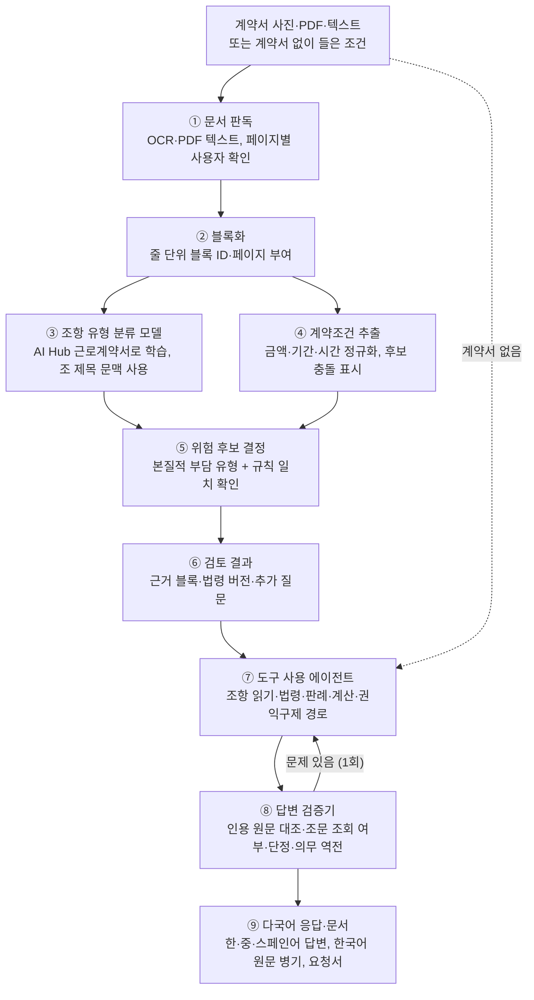

# AI 처리 구조

[[00 권리ON 전문기 구현 가이드|시작 노트]] · 이전: [[11 조항 분류 모델 실험]]

이 문서는 현재 코드가 실제로 수행하는 처리 순서를 단계별 입력·출력·검증 조건으로 정리한다. 특허 명세서의 "발명의 구성" 초안으로 사용하며, 각 단계 옆에 구현 위치를 적는다.

## 1. 전체 흐름

## 2. 단계별 구성

| 단계 | 입력 | 처리 | 출력 | 검증·안전 조건 | 구현 |
| --- | --- | --- | --- | --- | --- |
| ① 문서 판독 | 사진 최대 5장, PDF, TXT | 텍스트 레이어 우선, 없으면 OCR. 페이지마다 사용자가 원본과 대조·수정·확인 | 페이지별 확인된 텍스트 | 확인되지 않은 페이지·판독 불가 표시가 있으면 분석 거부 | `backend/reading.py`, `backend/schemas.py` |
| ② 블록화 | 확인된 텍스트 | 줄 단위 블록, `B0001` 형식 ID와 페이지 번호 | 블록 목록 | 이후 모든 근거는 블록 ID로만 참조 | `backend/extraction.py` `blocks_from_text` |
| ③ 조항 유형 분류 | 블록 + 직전 조 제목 | 학습된 다중 라벨 분류기(31개 유형), 라벨별 임계값 | 블록별 조항 유형, 근로기준법 제17조 필수 항목 누락 | 모델이 없으면 단계를 건너뛰고 규칙 검토로 동작 | `backend/clause_model.py`, `scripts/ml/` |
| ④ 계약조건 추출 | 블록 | 서식 규칙(+선택 시 모델) 추출, 금액·기간·시간 정규화 | 항목별 후보·상태(found/conflict/not_found) | 원문에 없는 값은 버림, 후보가 여럿이면 충돌로 표시 | `backend/extraction.py`, `backend/structure.py` |
| ⑤ 위험 후보 결정 | 조항 유형, 블록 문장 | 손해배상의 예정·경업금지·근로환경 변경은 유형과 함께 문장 표지(미리 정한 금액, 퇴직 후 제한, 근로자 동의 불요)가 있을 때 후보, 그 밖의 유형은 검토 규칙이 문장과 일치할 때만 후보 | 위험 유형과 근거 블록 | 부정문("위약금을 정하지 않는다")·조 제목·실손해 배상 원칙·재직 중 겸직 제한·동의 조건부 변경은 제외 | `backend/clause_labels.py` `wording_supports`, `scripts/ml/risk.py`, `backend/review.py` |
| ⑥ 검토 결과 | 후보, 추출값, 사용자 상황 | 사건일 기준 법령 버전 조회, 필요한 상황 질문 생성 | 쟁점·근거·질문·조치 | 법령 버전이 사건일에 적용되지 않으면 "근거 부족"으로 강등 | `backend/analysis.py` |
| ⑦ 에이전트 | 사건 요약, 대화, 사용자 질문 | 모델이 도구를 선택·호출: 조항 읽기, 조항 분류, 법령 조회, 판례·질의응답 검색, 실제 계약서 비교, 최저임금 계산, 사실 기록, 권익구제 경로, 요청서 작성 | 답변 초안, 인용, 되물음, 다음 행동 | 도구 결과는 데이터로만 취급, 최대 8단계 후 강제 종료 | `backend/agent/runner.py`, `tools.py` |
| ⑧ 검증기 | 답변 초안, 이번 실행에서 조회한 자료 | 인용 문구가 조회 원문의 연속 문자열인지 대조, 언급한 법령 조문을 조회했는지, 위법 단정, 당사자 의무 역전 검사 | 정리된 답변, 경고 | 문제가 있으면 1회 재작성 요청, 남은 문제는 숨기지 않고 경고 표시 | `backend/agent/verify.py` |
| ⑨ 응답 | 검증된 답변 | 사용자 언어 답변 + 한국어 답변 병기, 확인된 인용·원문 링크, 요청서 PDF | 화면·문서 | 사용자 사실은 사용자가 쓴 문구를 인용한 것만 기록, 화면에서 삭제 가능 | `frontend/src/components/AgentConversation.jsx` |

## 3. 다른 방식과 구별되는 점

1. **학습 모델과 규칙의 역할 분리.** 분류 모델은 "어떤 조항인가"만 판단하고, "불리한가"는 본질적 부담 유형이거나 규칙이 문장과 일치할 때만 후보가 된다. 근로시간·휴가처럼 흔하고 대부분 정상인 조항에서 오경고를 줄인다.
2. **실행 단위 근거 등록과 문자열 대조.** 에이전트가 한 번의 답변 동안 도구로 받은 원문만 인용 가능 목록에 등록하고, 인용은 그 원문의 연속 문자열이어야 한다. 법령 조문을 언급하려면 같은 실행에서 해당 조문을 조회해야 한다.
3. **숨기지 않는 검증.** 검증 실패 시 답변을 버리지 않고 1회 재작성 후, 남은 문제를 사용자에게 경고로 보여준다.
4. **사용자 발화 인용 기반 사실 기록.** 모델이 추론한 사실은 저장할 수 없고, 사용자 메시지에 실제로 있는 문구를 인용해야 저장된다.
5. **계약서 없는 경로.** 서면 계약서가 없거나 촬영이 어려운 경우 대화로 조건을 수집하고, 근로기준법 제17조 원문을 조회한 뒤 서면 교부 요청서를 생성한다.
6. **소유자 토큰 기반 접근 제어.** 분석·대화는 생성한 브라우저의 토큰으로만 열리며 서버에는 토큰 해시만 저장한다.

## 4. 평가 연결

| 평가 | 스크립트 | 결과 위치 |
| --- | --- | --- |
| 조항 유형 분류 (기준선·1차·2차) | `scripts/ml/evaluate_clause.py` | `var/ml/clause/report.json`, [[11 조항 분류 모델 실험]] |
| 위험 조항 탐지 (규칙 vs 모델+규칙) | `scripts/ml/draft_risk_labels.py` → 검수 → `scripts/ml/evaluate_risk.py` | `var/ml/risk/report.json` |
| 사용자 시나리오 (외국인 근로자 B 중·스페인어, 사회초년생 임차인, 전세사기 의심) | `scripts/ml/eval_agent_scenarios.py` | `var/evaluation/agent-scenarios.md` |
