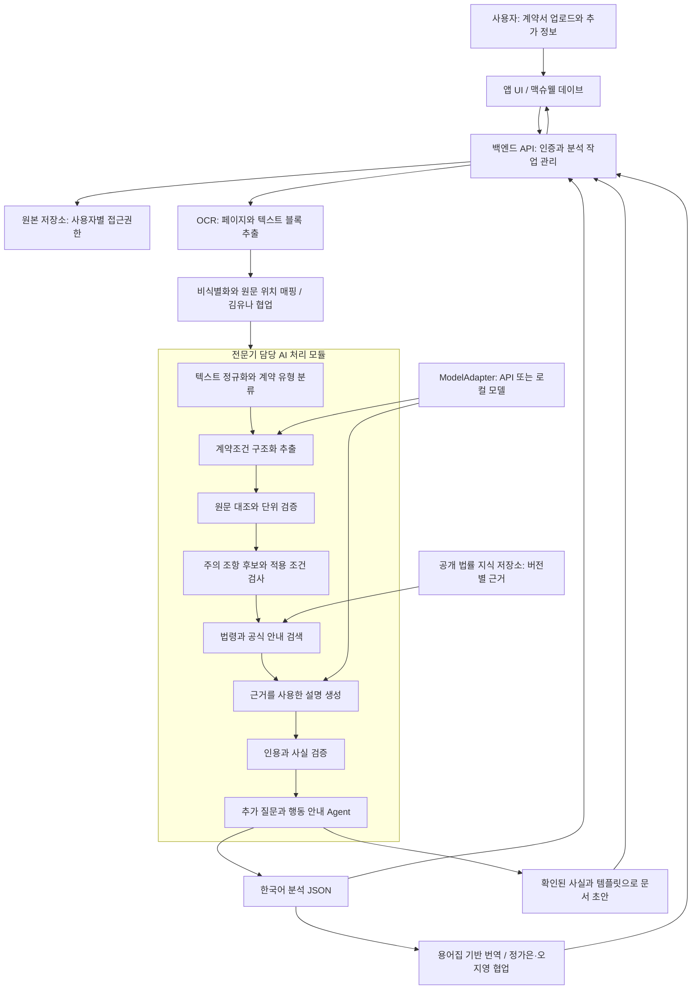
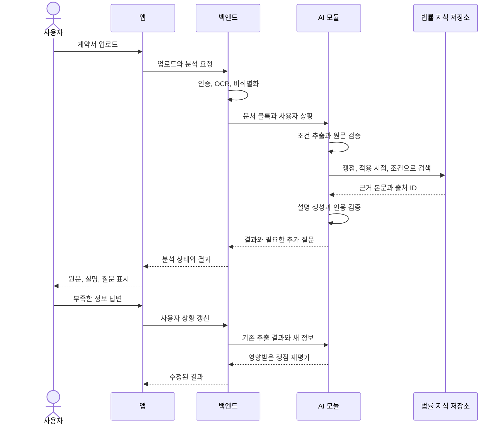
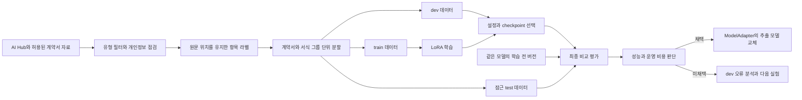
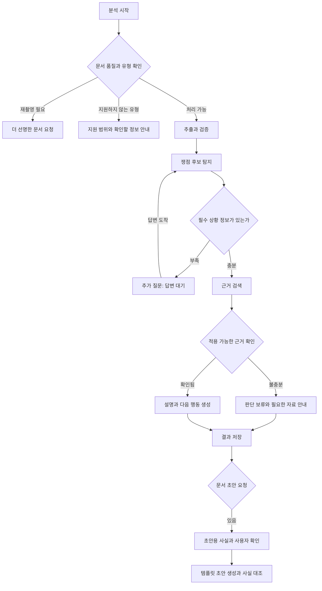

# 전체 아키텍처

[[00 권리ON 전문기 구현 가이드|시작 노트]] · 다음: [[02 기능별 구현 프로세스]]

## 1. 서비스 전체 구조

아래 상자는 **기능 모듈**이다. 초기에는 백엔드와 AI 코드를 하나의 Python 프로젝트에서 실행해도 된다. 로컬 모델이나 분석 부하가 커지면 AI worker를 별도 프로세스로 분리한다.



**핵심 경계:** 원본 계약서와 사용자 개인정보는 사용자 저장 영역에 둔다. RAG 지식 저장소에는 공개 법령·공식 안내·허용된 공개 자료만 넣는다. 사용자 계약서는 공용 검색 인덱스나 학습 데이터에 자동으로 편입하지 않는다.

## 2. 한 건의 계약서를 처리하는 순서



사용자 답변이 바뀌어도 OCR과 모든 모델 호출을 다시 실행할 필요는 없다. 계약서 텍스트 버전이 동일하면 조건 추출 결과를 재사용하고, 상황에 영향을 받는 법률 검색·판단 단계부터 재실행한다.

## 3. 학습과 개선 구조

서비스 실행과 모델 학습은 서로 다른 경로로 관리한다.



최종 test의 개별 오류를 보고 데이터·프롬프트를 수정하면 그 test는 다음 실험의 독립 평가로 쓰지 않는다. 학기 중 반복 개선은 dev로 진행하고, 13주차 최종 평가에 잠근 test를 사용한다.

## 4. Agent의 상태 흐름



이 상태 흐름의 전이는 Python 코드가 관리한다. LLM은 후보 추출·문구 생성 등 정해진 작업에 사용한다. 초기에는 질문 최대 2회, 검색 보완 최대 1회, 형식 재생성 최대 1회로 제한하고, 한도를 넘으면 현재까지 확인한 결과를 반환한다. 횟수는 평가 후 조정할 제안값이다.

## 5. 추천 기술 구성

| 영역 | 초기 제안 | 선택 이유와 교체 조건 |
| --- | --- | --- |
| AI API | Python + FastAPI + Pydantic | 팀 백엔드와 JSON 계약을 맞추기 쉽다. Pydantic은 형식 검증 담당이며 사실 검증 코드를 따로 둔다. |
| 모델 인터페이스 | 직접 작성한 `ModelAdapter` | `extract`·`explain`·`draft`를 같은 인터페이스로 호출한다. |
| 생성·추출 기준선 | JSON 출력이 가능한 API 모델 또는 로컬 Instruct 모델 | 20개 샘플을 비교해 정한다. 제공사·모델·가격은 구현 시점에 확인한다. |
| 학습 후보 | `Qwen/Qwen3-4B-Instruct-2507` | 소형 Instruct 실험 후보. 한국어 계약서 성능은 자체 평가로 판단한다. |
| 임베딩 후보 | `intfloat/multilingual-e5-small` | 작은 공개 지식 묶음의 검색 기준선으로 비교한다. |
| 공개 지식 저장 | SQLite 메타데이터 + NumPy 벡터 파일 | 수백~수천 청크 규모의 초기 실험을 단순하게 시작한다. |
| 검색 보완 | 쟁점 태그·법령명·조문 번호 필터 | 임베딩 검색이 놓치는 정확한 법령 식별자를 보완한다. |
| 학습 환경 | Apple Silicon: MLX LM / NVIDIA: Transformers + TRL + PEFT | 실제 장비에 맞춰 하나를 선택한다. |
| 분석 작업 | 데모: 단일 worker와 저장된 상태 / 확장: 별도 작업 큐 | 재시작 복구·동시 사용자 요구가 생기면 큐를 붙인다. |
| 문서 초안 | JSON 필드 + 검토된 텍스트 템플릿 | 먼저 텍스트 초안을 검증하고, 파일 출력은 후순위로 둔다. |

Qwen 후보의 명칭·라이선스는 [공식 모델 카드](https://huggingface.co/Qwen/Qwen3-4B-Instruct-2507), MLX의 Apple Silicon 추론·학습 지원은 [공식 저장소](https://github.com/ml-explore/mlx-lm)에서 확인했다. 임베딩 입력 규칙은 [[03 데이터와 법률 RAG]]에 정리했다.

## 6. 예상 코드 구조

```text
ai/
  schemas/          # OCR 입력, 추출 결과, 쟁점, 근거, 초안
  preprocessing/    # 정규화, 블록 분할, 위치 매핑
  extraction/       # 모델 호출, 항목별 원문 대조
  rules/            # 적용 조건, 단위, 쟁점 후보 규칙
  retrieval/        # 공개 자료 수집, 시점 필터, 검색
  generation/       # 쉬운 설명, 템플릿 초안, 사실 검증
  workflow/         # 상태 전이, 추가 질문, 재시도
  models/           # APIAdapter, LocalAdapter
  evaluation/       # 추출, 탐지, 검색, 시나리오 평가
training/
  prepare/          # 데이터 변환과 그룹 분할
  configs/          # 학습 설정과 고정 버전
  runs/             # checkpoint 정보와 평가 요약
```

개인 계약서·원본 개인정보·비밀키·허용되지 않은 데이터셋 원문은 Git에 넣지 않는다. 위 경로는 설계안이며 현재 생성된 구현 코드는 아니다.
