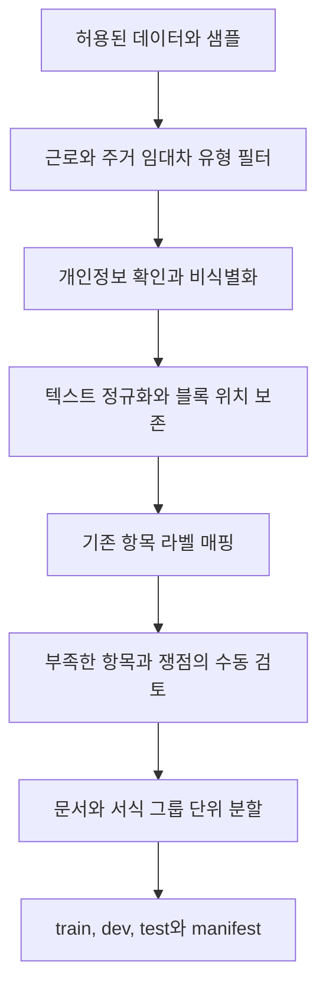

# 데이터와 법률 RAG

[[00 권리ON 전문기 구현 가이드|시작 노트]] · 이전: [[02 기능별 구현 프로세스]] · 다음: [[04 모델 학습과 기술 선택]]

## 1. 데이터를 세 종류로 나눈다

| 종류 | 들어갈 내용 | 사용 목적 |
| --- | --- | --- |
| 학습 데이터 | 허용된 계약서·항목 정답·쟁점 라벨 | 모델 행동을 개선한다. |
| 공개 근거 데이터 | 법령·공식 안내·선별한 판례 | 최신 근거를 검색한다. |
| 평가 데이터 | 독립 계약서·정답·검토된 시나리오 | 실제 성능을 비교한다. |

판결문 QA와 계약서 항목 추출은 서로 다른 작업이다. 학습 목표에 맞는 데이터만 변환하고, 공개 근거 데이터는 문서의 시점과 적용 조건을 함께 보존한다.

## 2. 확인한 AI Hub 후보

아래 표는 공식 소개를 기준으로 비교한 후보다. 2026-10-10에 로컬에 받은 계약법률문서·민사법 데이터를 점검했다. 실제 받은 범위·스키마·수량은 [[09 실제 데이터와 법령 API 점검]]을 기준으로 확인하고, 개별 이용조건은 데이터 manifest에 기록한다.

| 우선순위 | 데이터 | 활용 제안 | 확인할 한계 |
| --- | --- | --- | --- |
| 1 | [계약 법률 문서 서식 데이터, 71834](https://www.aihub.or.kr/aihubdata/data/view.do?currMenu=115&dataSetSn=71834&topMenu=100) | 근로·주거 임대차 유형을 필터링하고 항목 추출 학습에 사용 | 항목·형식/내용 태그를 우리 스키마로 매핑해야 한다. 위험 라벨은 별도로 검토한다. |
| 2 | [법률/규정 텍스트 분석 데이터, 580](https://www.aihub.or.kr/aihubdata/data/view.do?aihubDataSe=&currMenu=115&dataSetSn=580&topMenu=100) | 약관의 유·불리 라벨과 판단 이유를 쟁점 분류 실험에 참고 | 소비자 약관 라벨을 근로·주거 임대차에 그대로 적용하지 않는다. |
| 3 | [민사법 LLM 사전학습 및 Instruction Tuning 데이터, 71841](https://www.aihub.or.kr/aihubdata/data/view.do?aihubDataSe=&currMenu=115&dataSetSn=71841&topMenu=100) | 관련 QA·요약의 형식과 설명 실험에 참고 | 계약서별 항목 정답과는 다르다. 현행 근거로 사용하려면 시점 검증이 필요하다. |

71834의 공식 설명은 문서 카테고리와 가공항목의 형식·내용 태깅을 소개하며 근로계약·주거 임대차 유형을 포함한다. 위 활용 방향은 해당 설명에 대한 **설계 제안**이다. 실제 파일 구조·유효 샘플 수·위치 라벨의 단위는 다운로드한 샘플로 확인한다.

### 먼저 할 조사

1. 샘플과 데이터 설명서를 받아 JSON 구조·계약 유형·라벨 의미를 확인한다.
2. 이용약관, 개별 조건, 학습·시연·재배포 가능 범위를 `dataset_manifest`에 기록한다.
3. 우리 스키마로 옮길 수 있는 항목과 새로 라벨링할 항목을 구분한다.
4. 원문·이미지·좌표의 연결 여부와 이미 적용된 익명 처리를 확인한다.
5. 필터링 후 문서 수와 서식 중복 수를 세고, 사용할 규모를 결정한다.

다운로드 대기 중에는 직접 작성한 가상 계약서와 허용된 공개 서식으로 흐름을 검증한다. 개인이 제공한 실제 계약서는 학습 데이터로 자동 전환하지 않는다.

현재 받은 고용계약의 원문·라벨을 연결할 때는 **라벨 `format.position.line` → 원천 `sort_order`**로 위치를 맞추고 텍스트를 대조해야 한다. 원천·라벨의 section `id`는 같다고 가정하지 않는다. 이 구조와 미일치 수는 [[09 실제 데이터와 법령 API 점검]]에 있다.

## 3. 내부 표준 데이터

아래는 AI Hub 원본 형식이 아니라 **권리ON 내부 정답 형식의 제안**이다.

```json
{
  "document_id": "gold-employment-001",
  "source_document_id": "source-001",
  "template_group_id": "employment-template-a",
  "contract_type": "employment",
  "text_version": "normalized-v1",
  "blocks": [
    {"block_id": "B001", "page": 1, "text": "월급은 250만원으로 한다."}
  ],
  "terms": [
    {
      "key": "wage",
      "value_text": "250만원",
      "normalized_value": {"amount": 2500000, "currency": "KRW", "period": "month"},
      "evidence": [{"block_id": "B001", "start": 0, "end": 15, "quote": "월급은 250만원으로 한다."}],
      "status": "found"
    }
  ],
  "issue_labels": [],
  "annotation_status": "reviewed"
}
```

`start`・`end`는 비식별화·정규화가 끝난 블록 텍스트의 **Unicode 코드포인트 기준, 끝 위치 미포함**이다. 원본 이미지 위치는 별도의 블록 매핑으로 연결한다. 숫자 정규화가 원문 텍스트를 덮어쓰지 않도록 한다.

## 4. 정제와 라벨링 프로세스



### 라벨 작성 규칙

- 정답값에 원문 근거를 반드시 연결한다.
- 같은 의미의 표현과 실제로 다른 조건을 구분한다.
- 항목을 못 찾은 이유를 `absent`, `unreadable`, `conflicting`으로 구분한다.
- 쟁점 라벨에 검토자, 검토일, 근거 ID, 적용 조건을 기록한다.
- 모델이 제안한 라벨은 `unreviewed`로 두고, 검토 전에는 gold 정답으로 평가하지 않는다.
- 계약서 유형에 맞지 않는 약관 라벨은 제외하거나 새 정의로 재검토한다.

### 데이터 누수 방지

한 계약서의 여러 조항, 이름·금액만 바뀐 복제본, 같은 서식의 변형본은 하나의 그룹으로 묶는다. 그룹 전체를 한 분할에 넣고, 해시와 유사 텍스트를 이용해 분할 간 중복을 검사한다.

최소 검토 목표는 **독립 문서 40개: train용 검토 10개, dev 10개, 최종 test 20개**를 제안한다. 여기에 기존 라벨을 매핑한 train 사례를 추가한다. 최종 test 구성과 표본의 한계는 [[06 평가와 완료 기준]]에 있다. 큰 원본 집합은 그룹별 약 80/10/10 분할을 시작점으로 쓰되, test와 겹치는 파생 데이터는 train에서 제거한다.

## 5. RAG 자료의 기준

### 수집 우선순위

1. 법령 원문과 시행일·연혁.
2. 관련 기관의 공식 절차·서식·생활법률 안내.
3. 해당 쟁점을 검토하는 데 필요한 판례·해석례.

[국가법령정보 공동활용 API 가이드](https://open.law.go.kr/LSO/openApi/guideList.do)는 현행·연혁 법령, 조항호목, 판례 등의 조회 항목을 제공한다. 구현 전 필요한 API의 이용 신청·응답 형식·인증 방식은 해당 상세 가이드에서 확인한다.

**처음에는 근로 쟁점 5~8종과 임대차 쟁점 3~5종에 필요한 근거 묶음을 수동 검토하여 구축**한다. 모든 법률을 한꺼번에 수집하는 작업은 후순위다.

### 청크에 저장할 정보

| 필드 | 목적 |
| --- | --- |
| `source_id`, `snapshot_id`, `chunk_id` | 동일 근거와 특정 버전을 식별한다. |
| `source_type`, `title`, `official_url` | 법령·판례·안내를 구분하고 출처를 연다. |
| `law_id`, `article_id` | 조문을 정확하게 조회한다. |
| `effective_from`, `effective_to` | 기준 시점에 적용 가능한 버전을 고른다. |
| `published_at`, `retrieved_at`, `last_verified_at` | 수집·게시·검증 시점을 구분한다. |
| `contract_types`, `issue_tags` | 관련 분야를 필터링한다. |
| `text`, `content_hash`, `parent_id` | 본문·변경·인접 문맥을 추적한다. |

법령은 조·항·호 구조를 우선 보존한다. 긴 조문은 의미 단위로 나누되 상위 조문 ID를 유지하고, 예외·단서가 다른 청크에 있으면 함께 가져온다. 판례는 사건 정보·사실관계·쟁점·판단을 구분한다.

## 6. 검색 구현

1. 쟁점 태그와 계약 유형으로 공개 근거 후보를 좁힌다.
2. 사건 시점 또는 분석 시점을 확인해 해당 버전을 선택한다. 시점이 모호하면 질문하거나 기준 시점을 명시한다.
3. 법령명·조문 번호를 아는 경우 ID로 직접 조회한다.
4. 나머지 후보는 임베딩 유사도로 검색한다.
5. 상위 5개 후보를 시작점으로 본문·인접 문맥을 검사한다.
6. 적용 조건이 맞는 근거만 생성 단계에 전달한다.

임베딩 후보 `intfloat/multilingual-e5-small`은 공식 카드에서 384차원과 검색용 `query: `·`passage: ` 접두사를 안내한다. 두 종류의 입력을 구분하고 정규화된 벡터를 비교한다. 입력은 모델 tokenizer의 한도 안에서 청크화한다. [공식 모델 카드](https://huggingface.co/intfloat/multilingual-e5-small)

```text
query: 근로계약 임금 지급일 확인에 필요한 기준
passage: [법령명 / 조문명 / 시행일] + 검증된 본문
```

코사인 유사도에 임의의 공통 임계값을 붙여 법률 근거가 충분하다고 판단하지 않는다. dev 검색 질의에서 순위와 근거 적합성을 평가해 검색·보류 기준을 정한다.

## 7. 업데이트와 검증

- 시연 준비 때 공식 원문과 저장된 snapshot을 대조한다.
- 실제 운영 단계에서는 정기 수집 작업으로 변경 해시를 확인한다.
- 변경된 근거를 새 snapshot으로 저장하고 인덱스를 갱신한다.
- 예전 분석은 사용한 snapshot ID를 유지한다. 사용자가 재분석을 요청하면 새 기준으로 결과를 생성한다.
- 데이터 갱신이 실패하면 검증 시점을 표시하고, 최신성 확인이 필요한 쟁점은 보류한다.

### RAG 완료 기준

- [ ] 지정한 쟁점마다 검토된 공식 근거가 등록돼 있다.
- [ ] 출처 URL, 실제 본문, 버전·시행일을 추적할 수 있다.
- [ ] 평가 질의의 필요한 근거가 상위 검색 결과에 포함된다.
- [ ] 틀린 조문·다른 시점·관련 없는 사례가 적절히 제외된다.
- [ ] 검색에 실패한 사례가 확인할 자료를 안내한다.
