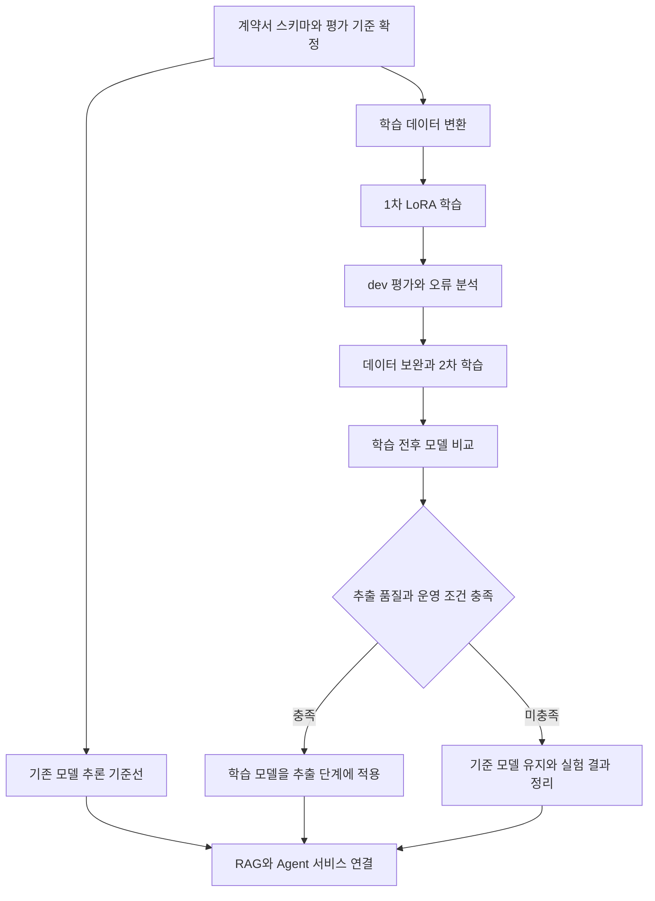

# 모델 학습과 기술 선택

[[00 권리ON 전문기 구현 가이드|시작 노트]] · 이전: [[03 데이터와 법률 RAG]] · 다음: [[05 API와 팀 연동]]

## 1. 추천하는 개발 경로

**전체 서비스 흐름을 만드는 작업과 소형 모델 학습을 함께 진행한다.** 계획서 5·6주차의 학습 환경·1차 학습, 10주차의 추가 학습, 13주차의 최종 평가는 실험 산출물로 남긴다.



학습 결과가 나빠도 데이터·실험·비교 결과는 계획서의 연구 산출물이 된다. 서비스 채택 여부는 평가 결과를 근거로 별도로 결정한다.

## 2. 선택지 비교

| 방식 | 필요한 작업 | 장점 | 비용·제약 | 판단할 때 볼 것 |
| --- | --- | --- | --- | --- |
| API 모델 + RAG | 비식별 입력, JSON 처리, 검색, 호출 제한 | 전체 기능 기준선을 빨리 만들기 쉽다. | 호출료·네트워크·제공사 데이터 처리 조건 | 계약서별 정확도, 외부 전송 가능 범위, 건당 비용 |
| 로컬 Instruct + RAG | 모델 실행 환경, 입력 길이·메모리 조정 | 입력을 로컬 환경에서 처리할 수 있다. | 장비 자원·추론 속도·구조화 출력 검증 | 20개 샘플의 성능, 최대 입력 길이, 메모리 |
| 로컬 LoRA + RAG | 라벨 데이터, 학습·평가, adapter 배포 | 목표 항목 추출 행동을 직접 개선할 수 있다. | 라벨 검토·학습 장비·재현성 관리 | 동일 모델 학습 전후 개선과 실사용 성능 |
| API 추출·설명 + 로컬 학습 실험 | 두 실행 경로의 인터페이스 통일 | 서비스 개발과 학습 요구를 함께 진행할 수 있다. | 비교 모델과 비용 기록을 구분해야 한다. | 시연 완성도와 학습 전후 비교표 |

**기본 제안:** 첫 서비스 기준선은 API 또는 바로 실행 가능한 로컬 모델 중 샘플 평가가 좋은 쪽으로 정하고, LoRA 실험은 로컬 소형 모델로 진행한다. 사용자의 데이터 전송·장비·비용 선택에 따라 기준 모델을 결정한다.

## 3. 후보 모델과 환경

### 학습 후보

`Qwen/Qwen3-4B-Instruct-2507`을 초기 소형 학습 후보로 제안한다. 공식 카드에서 4B 규모, non-thinking Instruct 유형, Apache-2.0 라이선스를 확인했다. **한국어 계약서 추출 성능은 이 프로젝트의 평가로 확인해야 한다.** [공식 모델 카드](https://huggingface.co/Qwen/Qwen3-4B-Instruct-2507)

계약서를 읽는 모델과 설명을 만드는 모델은 같아도 되고 달라도 된다. 처음에는 한 모델로 연결한 뒤 추출 단계에만 학습 adapter를 적용하면 변화의 원인을 비교하기 쉽다.

### 장비별 경로

| 실제 장비 | 학습 경로 | 먼저 확인할 것 |
| --- | --- | --- |
| Apple Silicon Mac | MLX LM의 LoRA·양자화 학습 | 모델 지원, 메모리, chat template, adapter 로드 |
| NVIDIA GPU | Transformers + TRL SFTTrainer + PEFT LoRA/QLoRA | CUDA 환경, 메모리, tokenizer, quantization 지원 |
| 장비가 부족한 경우 | 승인된 GPU 환경에서 소규모 실험 | 데이터 반출 범위, 비용 상한, 실행 시간 |

[MLX LM](https://github.com/ml-explore/mlx-lm)은 Apple Silicon의 추론·파인튜닝을 지원하며, [TRL SFTTrainer](https://huggingface.co/docs/trl/en/sft_trainer)는 대화·prompt-completion 데이터와 PEFT adapter 학습을 지원한다. 구체적 옵션은 사용할 버전을 고정한 뒤 확인한다.

MLX adapter와 Hugging Face PEFT adapter는 실행·저장 형식이 다를 수 있다. 처음에는 **학습한 실행 환경에서 그대로 추론**하고, 형식 변환·다른 런타임 배포는 별도 검증 작업으로 잡는다.

## 4. 무엇을 학습할지

첫 학습 목표는 계약조건 추출이다.

| 목표 | 입력 | 정답 출력 |
| --- | --- | --- |
| 1차: 조건 추출 | 한국어 근로계약 조항 또는 짧은 계약서 | 항목·값·원문 인용·블록 ID |
| 2차: 추출 개선 | 누락·충돌·다양한 표현을 포함한 train 데이터 | 검토된 추출값과 미확인 상태 |
| 후속 실험: 쟁점 분류 | 조항·필요한 상황 정보 | 쟁점 태그·적용 조건·추가 질문 |

법령 지식은 RAG에서 조회한다. 학습 데이터에는 근거 없이 확정 결론을 만드는 응답을 넣지 않는다. 판결문 QA는 계약조건 추출 데이터와 태스크를 구분하며, 첫 실험에서 무조건 섞지 않는다.

### 학습용 JSONL의 형태

실제 학습 파일은 한 줄에 한 JSON 객체를 둔다. 아래는 읽기 쉽게 펼친 **가상 예시**다.

```json
{
  "messages": [
    {"role": "system", "content": "계약조건을 JSON으로 추출한다. 없는 값은 null로 둔다. 원문과 block_id를 포함한다."},
    {"role": "user", "content": "유형: employment\nB001: 월급은 250만원으로 한다."},
    {"role": "assistant", "content": "{\"terms\":[{\"key\":\"wage\",\"value_text\":\"250만원\",\"amount\":2500000,\"currency\":\"KRW\",\"period\":\"month\",\"block_id\":\"B001\",\"quote\":\"월급은 250만원으로 한다.\"}]}"}
  ]
}
```

모델이 만든 초안 정답은 사람이 검토한 뒤 train에 넣는다. 검토가 어려운 자동 라벨은 별도 표시하고, 독립 test에는 포함하지 않는다.

## 5. 실제 학습 순서

1. **환경 smoke test:** 20개 학습 사례로 소수 step을 실행해 입력·loss·checkpoint 저장·재로드를 확인한다.
2. **기준선 저장:** 같은 모델의 학습 전 추출 결과를 dev에 저장한다.
3. **1차 실험:** 기존 라벨을 매핑한 200~500개 사례를 목표로 시작한다. 확보·검토 가능한 양에 맞춰 줄여도 된다.
4. **dev 평가:** 항목별 추출·원문 일치·숫자 정규화·JSON 성공률을 비교한다.
5. **오류 원인 구분:** 데이터 라벨·전처리·모델 추출·후처리 오류를 나눈다.
6. **2차 실험:** train 오류 사례를 보완하고, dev에서 checkpoint를 고른다.
7. **최종 평가:** 선택된 모델을 잠근 test에서 학습 전 모델 및 서비스 기준 모델과 비교한다.
8. **채택 결정:** 평가와 메모리·지연·비용을 보고 추출 단계 적용 여부를 정한다.

`200~500`은 파이프라인과 개선 가능성을 확인할 시작 규모다. 일정한 성능을 보장하는 수량은 아니다. [[03 데이터와 법률 RAG]]의 그룹 분할을 먼저 수행해야 한다.

### 초기 설정 제안

아래 값은 탐색 시작점이며 MLX와 TRL의 실제 설정 이름으로 각각 옮긴다.

| 항목 | 시작값 | 조정 기준 |
| --- | --- | --- |
| LoRA rank | 8 | dev 성능과 메모리 |
| LoRA target | attention의 `q_proj`, `v_proj` 후보 | 선택 모델의 모듈명·학습 라이브러리 지원 확인 |
| learning rate | `1e-4` | loss와 dev 품질 |
| micro batch | 1 | 장비 메모리 |
| gradient accumulation | 8 | 유효 batch와 학습 안정성 |
| 최대 입력 토큰 | 1024에서 시작 | 긴 조항을 잘라 정답을 잃지 않는지 확인 |
| epochs | 1부터 시작, 필요하면 2~3 비교 | dev 악화·과적합 여부 |
| loss 범위 | 정답 응답 부분 우선 | chat template와 trainer의 마스킹 지원 확인 |

토큰 한도를 넘는 사례는 조항 단위로 재구성하거나 별도 긴 문서 처리 대상으로 분류한다. 정답을 잘라낸 상태로 학습시키지 않는다. LoRA 설정의 의미는 [PEFT 공식 문서](https://huggingface.co/docs/peft/en/developer_guides/lora), 응답 부분 학습 옵션은 [TRL 문서](https://huggingface.co/docs/trl/en/sft_trainer)를 기준으로 확인한다.

## 6. 기록할 실험 산출물

```text
experiment_id
task_schema_version
model_id + model_revision
tokenizer_revision + chat_template
dataset_manifest + split_hash
library_versions + hardware
training_config + random_seed
adapter_path + selected_checkpoint
dev_metrics + final_test_metrics
inference_settings + prompt_version
peak_memory + elapsed_time
```

**학습 loss 감소, 스키마 성공률, 실제 추출 품질을 따로 기록**한다. 원문과 맞지 않는 JSON은 형식이 정상이어도 추출 실패다.

## 7. 비용과 일정 판단

API 호출비는 다음 형태로 계산한다.

```text
건당 비용 = 입력 토큰 / 1,000,000 × 입력 단가
          + 출력 토큰 / 1,000,000 × 출력 단가
          + OCR 등 추가 호출비
          + 재시도 호출비
```

실험 비용은 `문서 수 × 문서당 호출 단계 × 모델 후보 수 × 반복 수`로 먼저 예상한다. 정확한 가격과 모델 제공 여부는 실제 선택 시 공식 가격표로 확인한다.

학습은 개발자의 작업 시간과 장비 실행 시간을 구분한다. 주차별 3시간 학습 작업에는 설정·실행·로그 확인을 계획하되, 모델 다운로드나 학습 대기 시간이 그 안에 끝난다고 가정하지 않는다. 전체 작업 배분은 [[07 주차별 작업과 결정표]]에 있다.
