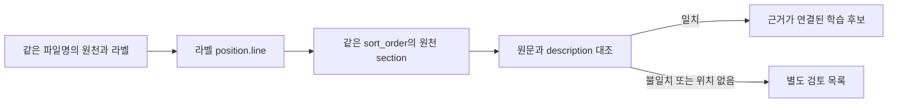

# 실제 데이터와 법령 API 점검

[[00 권리ON 전문기 구현 가이드|시작 노트]] · 설계: [[03 데이터와 법률 RAG]] · 다음 작업: [[04 모델 학습과 기술 선택]]

> [!summary] 지금 가능한 작업
> 법령 API의 목록·본문 조회를 확인했고, 근로·아르바이트 계약서의 원문·항목 라벨을 확보했다. 다음 구현은 **해당 계약서 필터링 → 원문·라벨 정렬 → 10건 정답 검토 → 기준 모델 추출 비교**다.

## 1. 이번에 실제로 한 일

- `.env`의 기존 `legal_api_key`를 유지하고 공식 목록·본문 URL을 추가했다.
- 법령 4종을 실제 API로 조회해 목록·본문의 이름·법령 ID·시행일을 대조했다.
- 다운로드 ZIP 38개의 파일 목록과 ZIP별 JSON 스키마 샘플을 확인했다.
- 다운로드된 계약법률문서 라벨 메타데이터 1,541건을 읽어 종류를 구분했다.
- 고용계약 원문·라벨 577쌍을 읽어 대응 관계·내용 일치·좌표 유무를 확인했다.
- API 오류·잘못된 버전을 성공으로 처리하지 않는 자동 테스트 6개가 통과했다.

민사법 JSON 전체 내용과 ZIP 전체 CRC는 검사하지 않았다. 파일 목록·샘플 스키마와 고용계약의 실측 결과를 구분해 읽어야 한다.

## 2. 법령 API 설정과 결과

```text
목록 URL: https://www.law.go.kr/DRF/lawSearch.do
본문 URL: https://www.law.go.kr/DRF/lawService.do
인증: .env의 legal_api_key → 요청 변수 OC
목록: target=eflaw, type=JSON, nw=3
본문: target=eflaw, type=JSON, MST, efYd
```

API URL과 요청 변수는 [공식 목록 가이드](https://open.law.go.kr/LSO/openApi/guideResult.do?htmlName=lsEfYdListGuide), [공식 본문 가이드](https://open.law.go.kr/LSO/openApi/guideResult.do?htmlName=lsEfYdInfoGuide)를 기준으로 설정했다. HTTP 문서 주소 대신 HTTPS endpoint로 요청해 실제 응답을 확인했다.

| 실제 조회한 법령 | 법령 ID | 버전 MST | 응답 시행일 | 조문 항목 수 | 결과 |
| --- | --- | --- | --- | --- | --- |
| 근로기준법 | 001872 | 285279 | 2026-10-08 | 132 | 목록·본문 통과 |
| 근로기준법 시행령 | 003058 | 270551 | 2025-10-23 | 80 | 목록·본문 통과 |
| 최저임금법 | 000129 | 218303 | 2020-05-26 | 34 | 목록·본문 통과 |
| 주택임대차보호법 | 001248 | 276291 | 2026-01-02 | 42 | 목록·본문 통과 |

위 수치는 2026-10-10의 실제 API 응답 snapshot에서 확인했다. 조문 항목 수는 `조문여부=조문`인 항목 수이고 삭제·가지 조문이 포함될 수 있다. 근로기준법 전체 `조문단위`는 145개이며 장 제목 등 13개를 제외하면 132개다.

이 결과는 **연결과 응답 구조 확인**이다. 쟁점별 적용 법령·예외·판단 정답의 검토는 다음 단계다. 현행 목록에서 선택한 snapshot을 사용했으며, 과거 사건용 연혁 조회·다른 종류 API·XML 응답은 이번에 테스트하지 않았다.

### 재실행

프로젝트 루트에서 실행한다.

```bash
python3 scripts/check_law_api.py
```

근로기준법 결과는 `var/law-api/check_report.json`, `search.json`, `law_body.json`에 있다. 추가 법령 결과는 같은 폴더 아래 `employment-decree`, `minimum-wage`, `housing-lease`에 있다. 인증값과 인증값이 붙은 URL은 출력·저장하지 않는다.

최초 요청에서는 HTTP 200의 검증 응답이 있었지만, 이후 재조회에서 4종이 정상 통과했다. 최초 응답의 원인은 확정하지 않았다. 점검 코드는 HTTP 상태와 별도로 응답 내용·법령·버전을 검사한다.

## 3. 다운로드된 데이터 범위

ZIP 38개, 압축 파일 합계 약 803MB이며 JSON 파일 목록은 182,424개다. **원천·라벨·QA·요약 파일이 각각 있으므로 182,424를 독립 문서 수로 해석하면 안 된다.**

| 폴더 | 확인한 구성 | 현재 활용 |
| --- | --- | --- |
| `data/계약법률문서` | 고용계약·인사관리·표준약관·기타계약, Training/Validation | 계약서 항목 추출·조항 분류 |
| `data/민사법` | 판결문·법령·심결례·유권해석, QA·요약 | 설명·요약 실험의 후속 후보 |

현재 파일 목록에는 주거 임대차 계약서 ZIP과 별도의 580 법률/규정 분석 데이터셋 폴더가 보이지 않는다. 이를 지금 받은 데이터에 포함됐다고 가정하지 않는다.

### 고용계약 세부 구성

| 라벨의 세부 유형 | Training | Validation | 합계 |
| --- | --- | --- | --- |
| 근로(고용)계약서 | 149 | 18 | 167 |
| 아르바이트계약서 | 27 | 4 | 31 |
| 기타고용계약서 | 337 | 42 | 379 |
| 전체 고용계약 묶음 | 513 | 64 | 577 |

첫 근로계약 실험 후보는 **일반 근로계약 + 아르바이트: Training 176건, Validation 22건, 합계 198건**이다. 기타고용계약에는 다른 계약 형태가 들어 있으므로 유형을 검토하고 포함 여부를 정한다.

현재 파일명 기준 Training/Validation 겹침은 0건이다. 같은 서식의 변형까지 분리됐다는 의미는 아니므로, 정규화한 원문 해시·서식 유사도 검사를 추가해야 한다.

## 4. 실제 스키마와 연결 방법

```text
원천 JSON
document.sub_documents[]
  id                    원천 section 식별자
  sort_order            원천 section 정렬 순서
  contents[].text       원문 텍스트
  coordinate            현재 고용계약 전체에서 null

라벨 JSON
document.metadata.file_info.document_category.detail_category
document.sections[]
  id                    라벨 section 식별자
  format.position.line  원문 위치를 연결할 줄 순서
  content.content_labels[]  임금액, 근로 시간 등 항목 라벨
  content.description   라벨이 연결된 텍스트
```

**원천 section `id`와 라벨 section `id`를 동일한 값으로 결합하면 잘못된 원문이 붙는다.** 같은 문서 파일명을 먼저 연결하고, 라벨의 `format.position.line`을 원천의 `sort_order`로 연결한 뒤 텍스트를 대조해야 한다.



### 선택한 198건의 정렬 점검

| 점검 항목 | Training | Validation |
| --- | --- | --- |
| 라벨 section 수 | 9,033 | 904 |
| 줄 순서로 원천 section이 연결된 수 | 8,896 | 885 |
| 연결 후 텍스트가 정확히 일치한 수 | 8,531 | 834 |
| 위치 미연결·텍스트 불일치 합계 | 502 | 70 |

문서 수와 section 수를 구분한다. 위 일치는 앞뒤 공백 제거 후 원문 `contents[].text`를 줄바꿈으로 합친 값과 `description`을 비교한 결과다. 표·줄바꿈·분할 차이도 불일치에 포함될 수 있으며, 그 자체로 라벨 오류를 확정하지 않는다.

전처리에서는 우선 정확히 연결되는 section을 사용하고, 나머지를 재정렬·수동 검토한다. 맞지 않는 위치에 정답을 붙인 채 학습하지 않는다. 현재 고용계약 원천 section 33,251개에 이미지 좌표는 없으므로 실제 업로드 화면의 OCR 좌표 검증은 별도 데이터로 해야 한다.

## 5. 어떤 정답이 있는가

선택한 198건에서 해당 항목 **라벨이 최소 한 번 있는 문서 수**다. 해당 값이 올바르게 추출·정규화됐다는 점수는 아니다.

| 항목 라벨 | Training / 176문서 | Validation / 22문서 |
| --- | --- | --- |
| 임금액 | 171 | 18 |
| 근로 시간 | 147 | 17 |
| 근로 계약 기간 | 156 | 17 |
| 임금 지급일 | 121 | 11 |
| 근무 장소 | 112 | 12 |
| 휴게 시간 | 95 | 7 |
| 휴일 | 120 | 11 |

지금 라벨은 항목의 의미를 표시한다. 금액·단위·날짜의 정규화 정답, 위험 수준, 적용 조건, 검토된 법률 판단은 별도로 구성해야 한다. `손해배상의 예정` 같은 조항 분류를 실제 위법 정답으로 바꾸지 않는다.

## 6. 다음 구현 작업

1. 세부 유형으로 176/22문서를 필터링한다.
2. 줄 위치와 텍스트가 맞는 section을 내부 스키마로 변환한다.
3. 임금·시간·기간 중심으로 10문서의 정답을 검토한다.
4. 같은 문서·서식이 분할을 넘지 않게 해시·유사도 점검을 한다.
5. 기준 모델로 추출하고 원문·금액·단위를 대조한다.
6. 조회한 법령을 조문 단위로 정리하고, 첫 쟁점의 적용 조건을 검토한다.
7. 검토한 train/dev 구성이 마련되면 1차 LoRA를 실행한다.

현재 Validation 22건은 학기 최종 평가 후보로 보관하는 방식을 제안한다. 반복 개발용 dev는 Training 쪽에서 서식 그룹을 나눠 확보하고, 최종 test 구성을 확정하기 전에 중복·정답 검토를 마친다.

점검 재실행은 `python3 scripts/inspect_downloaded_data.py`, 전체 상세 결과는 `var/data-inspection/summary.json`이다.
