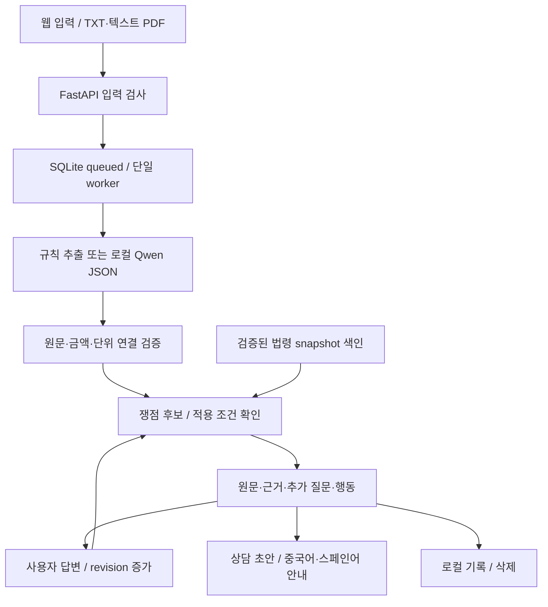

# 1차 MVP 실행과 검증

[[00 권리ON 전문기 구현 가이드|시작 노트]] · 이전: [[09 실제 데이터와 법령 API 점검]]

> [!summary] 바로 확인하기
> 프로젝트에서 `./run_app.sh`를 실행하고 http://127.0.0.1:8020 을 연다. 샘플을 선택한 뒤 **계약서 분석하기**를 누르면 원문·조건·법령·질문·초안까지 확인할 수 있다.

## 구현한 기능

| 기능 | 실제 구현 | 확인 방법 |
| --- | --- | --- |
| 입력·업로드 | 직접 입력, UTF-8 TXT, 텍스트 PDF | 5MB·20페이지·50,000자 제한 |
| 계약조건 추출 | 규칙 또는 로컬 Qwen JSON 추출 | 임금·기간·시간·보증금과 원문 대조 |
| 원문 근거 | 페이지·block ID·quote 검증 | ‘원문 보기’로 해당 줄 하이라이트 |
| 쟁점 확인 | 누락·충돌·수당·배상·시간, 주거·반환 조건 | 후보와 확인할 조건 표시 |
| 법령 근거 | 공식 snapshot 4종, 조문 288개 | 본문·시행일·조회일·공식 링크 열기 |
| 추가 질문 | 필요한 정보 선택, 사용자 답변으로 재평가 | 날짜·규모·시간·주거 상황 입력 |
| 상담 준비 | 상담 요약서·사실확인 요청문 | 편집·복사·TXT 저장 |
| 다국어 | 중국어 간체·스페인어 안내 템플릿 | 원문·숫자·답변·출처 보존 |
| 분석 기록 | SQLite 저장·revision·삭제·재시작 복구 | 최근 분석에서 다시 열기 |

추출은 모델과 규칙 중 사용자가 선택한다. 쟁점 확인·질문·행동·초안은 코드와 템플릿이 제어하는 첫 Agent 흐름이다. 모델을 학습하거나 자유 대화 Agent를 완성한 상태는 아니다.

## 추천 시연 순서

1. **기본 항목이 있는 근로계약**: 월급 250만원, 주 40시간, 휴게 60분을 확인하고 원문을 연다.
2. **지급일과 휴게시간이 빠진 계약**: 찾지 못한 조건과 전체 페이지 확인 질문을 본다.
3. **월급이 서로 다른 계약**: 250만원·230만원 후보가 모두 남아 있는지 본다. 초안이 하나의 월급을 임의로 정하지 않는지 확인한다.
4. **수당·퇴사 배상 특약이 있는 계약**: 날짜, 사업장 규모, 실제 주당 시간을 답한다. 질문 상태가 갱신되는지 확인하고 법령을 펼쳐본다.
5. **처음 확인하는 주택 임대차계약**: 보증금·월세와 입주·전입신고 확인 항목을 본다.
6. **보증금 반환을 준비하는 계약**: 보증금 반환 여부에 ‘아니오’를 입력한다. 미반환 상황의 상담 준비 항목을 확인한다.

샘플은 모두 직접 생성한 합성 문서다. 임대차 샘플은 내려받은 AI Hub 데이터에 임대차 원문이 있다고 가정해서 만든 자료가 아니다. `samples/manifest.json`의 기대 결과는 기능 회귀 확인용이며 전문가 판단 정답이나 실데이터 성능 평가가 아니다.

## 검증 결과

- `.venv/bin/python -m unittest discover -s tests -v`: **23개 통과**. 기존 법령 API 6개와 새 MVP 17개를 포함한다.
- 브라우저: 샘플 6종 분석, 원문 하이라이트, 법령 펼치기, 답변 revision, 두 초안, TXT 저장, 두 언어, PDF 업로드, 새로고침 후 결과 복원, 삭제를 통과했다.
- 화면 너비 375·768·1024·1440px에서 가로 넘침이 없었다. 모바일 최근 기록 메뉴, 키보드 탭 이동과 줄인 동작 설정도 확인했다.
- 실제 `qwen2.5:7b`: 기본 근로계약 샘플에서 항목 8개를 추출했고 월급 250만원·월 단위·휴게 60분을 대조했다. 마지막 실행은 약 **9.3초**, 원문 검증에서 제외한 후보 0개였다. 한 샘플 결과이므로 추출 정확도 전체 점수로 해석하지 않는다.
- PDF 6개를 렌더링해 한글·여백·줄바꿈·페이지 번호를 확인했다. TXT와 PDF에서 기대 쟁점 집합이 일치했다.

검증 보고서와 화면은 `var/mvp-review/`에 있다. 테스트 환경에서 Starlette가 `httpx` 사용에 대한 deprecation 경고를 출력하지만 이번 검증은 통과했다.

## 실제 처리 구조

전체 실행 안내·API 스키마와 재생성 명령은 프로젝트 `README.md`를 따른다. PDF 재생성에는 한국어 TTF 글꼴과 ReportLab이 필요하다. 다른 환경에서는 `GWOLLION_PDF_FONT`로 글꼴을 지정한다.

## 현재 한계와 다음 판단

사진·스캔 OCR, 좌표 하이라이트, 최저임금·손해액 계산, 등기·판례 조회, 자동 법령 갱신·과거 연혁 조회, LoRA 학습, 사람의 번역·법률 검수, 로그인·다중 사용자 운영은 아직 구현하지 않았다. 과거 사건일이 저장된 법령보다 앞서면 적용 근거 부족으로 표시한다. 주거 계약만으로 소유권·권리 순위·사기 피해를 확정하지 않는다.

다음 실험은 [[09 실제 데이터와 법령 API 점검]]에서 확인한 실제 근로·알바 계약서 중 10건을 정렬하고 기준 추출과 비교하는 것이다. 기능 흐름은 이 MVP로 확인하고, 실제 데이터 오류표를 보고 추출 보완·학습 여부를 결정한다.
